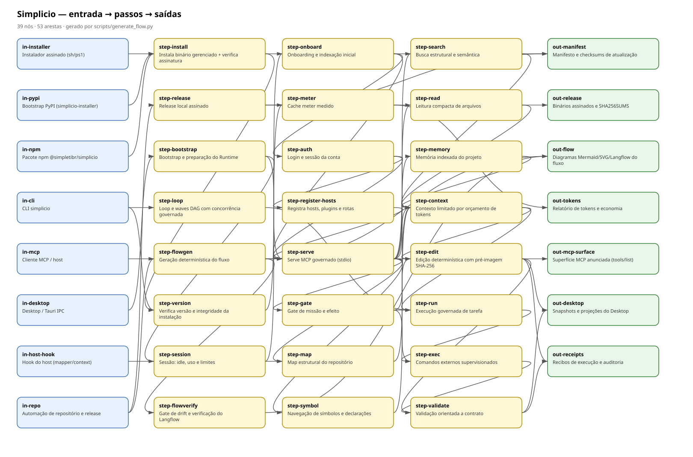

# ⚡ Simplicio

> **The High-Performance Native AI Coding Runtime & Agent (100% Rust)**  
> A page a generator covers takes 14 s and $0.0021, against 166 s and $0.0215 on 3.9.2. Local orientation, atomic edits and governed concurrency.

<p align="center">
  
</p>

## Fluxo visível



O fluxo (8 entradas, 24 passos, 7 saídas) é gerado de `docs/flow/simplicio.flow.json` (fonte única) e cobre todos os comandos públicos da CLI e todas as MCP tools documentadas:

```bash
python3 scripts/generate_flow.py            # regenera mmd/svg/langflow
python3 scripts/generate_flow.py --check    # gate de drift antes do release
python3 -m pytest tests/test_flow_contract.py -q
```

Artefatos: `simplicio.mmd`, `simplicio.svg` e `langflow/simplicio.langflow.json`.

Render Mermaid validado com `mmdc` (evidência e hashes em `docs/flow/render/`).
O import no Langflow 1.12.0 foi **verificado** localmente: recibo em `docs/flow/evidence/langflow-verify.json`
e `GET /api/v1/flows/{id}` em `docs/flow/evidence/langflow-readback.json`.
Sem servidor, `scripts/verify_flow_langflow.py` é fail-closed (exit 2, `status=blocked`).
Requisitos e repro: [docs/flow/README.md](docs/flow/README.md).

<p align="center">
  <a href="https://github.com/simpletibr/simplicio/releases/latest"></a>
  <a href="https://simpleti.com.br/simplicio/docs"></a>
  <a href="https://github.com/simpletibr/simplicio/stargazers"></a>
  
  
</p>

<p align="center">
  <a href="#-quick-install">Quick Install</a> •
  <a href="#-measured-benchmark-simplicio-3108-vs-392-vs-no-mcp">Benchmarks</a> •
  <a href="#-first-60-seconds">First 60 Seconds</a> •
  <a href="#-mcp--ide-integration">MCP & IDEs</a> •
  <a href="#-core-architecture">Architecture</a> •
  <a href="https://simpleti.com.br/simplicio/docs">Full Documentation</a>
</p>

---

## ⚡ What is Simplicio?

**Simplicio** is a single-binary, local-first runtime and AI coding agent built in 100% Rust. It replaces heavy context dumps and fragmented Python tools with mathematical token bounding, cryptographic atomic edits, and hardware-governed multi-agent orchestration.

- **100% Native Rust**: Single ~46MB standalone binary. No Python, virtualenvs, or heavy background processes.
- **Ultra-Low Latency**: ~4ms cold start vs. seconds in interpreted runtimes.
- **Token Economy**: A generator writes what it covers with 0 LLM tokens, and bounded context replaces raw file trees for the rest. See the [benchmark](#-measured-benchmark-simplicio-3108-vs-392-vs-no-mcp).
- **Fail-Closed Safety**: Every code modification uses SHA-256 pre-image checks, atomic replacements, and immutable audit receipts.

---
## 📊 Measured Benchmark: Simplicio 3.10.8 vs 3.9.2 vs No MCP

A real model creates a file and edits it in the same session. The result is checked outside the session: pages in headless Chrome, scripts by running them. 60 sessions on 2026-10-31, medians.

| Task | Setup | n | Time | Model requests | Output tokens | Cost | Delivered |
|:---|:---|---:|---:|---:|---:|---:|---:|
| **Page from a JSON file**, a generator covers it | **Simplicio 3.10.8** | 10 | **14.1 s** | **6** | **602** | **$0.0021** | **10/10** |
| | Simplicio 3.9.2 | 10 | 166.2 s | 24.5 | 19,944 | $0.0215 | 10/10 |
| | No MCP | 10 | 176.3 s | 32.5 | 17,929 | $0.0203 | 10/10 |
| **New page**, other data, other language, not used to build the generator | **Simplicio 3.10.8** | 6 | **14.1 s** | **6** | **524** | **$0.0010** | **6/6** |
| | Simplicio 3.9.2 | 6 | 110.9 s | 17.5 | 16,091 | $0.0153 | 6/6 |
| **Python script**, no generator covers it | **Simplicio 3.10.8** | 6 | **30.7 s** | **10.5** | **1,796** | **$0.0031** | **6/6** |
| | Simplicio 3.9.2 | 6 | 34.1 s | 11.5 | 2,485 | $0.0051 | 6/6 |
| | No MCP | 6 | 22.7 s | 8 | 1,268 | $0.0024 | 6/6 |

The gain comes from the generator: on the page tasks, `simplicio_map` routes the request and `simplicio_codegen` writes the file with 0 LLM tokens. On a task no generator covers, 3.10.8 beats 3.9.2 and costs about 8 s and $0.0007 more per session than no MCP at all.

> **Setup:** OpenCode 2.1.4, DeepSeek V4.1 Flash on one fixed OpenRouter endpoint, the same for every run. Cost is computed at $0.15 input, $0.60 output and $0.003 cache read per million tokens. Measured on commit `6e232bb`; one real session per task repeated it on the release code. **Prompts, method and limits:** [`benchmarks/2026-10-31-map-codegen.md`](benchmarks/2026-10-31-map-codegen.md) · **Per-session data:** [`benchmarks/2026-10-31-map-codegen.json`](benchmarks/2026-10-31-map-codegen.json).

Same tasks on other models, with and without Simplicio. Each model ran in one client, so compare a model with itself.

| Model | Task | Simplicio 3.10.8 | No MCP | Delivered |
|:---|:---|---:|---:|---:|
| **Claude Sonnet 5.5** (Claude Code) | Page from a JSON file, a generator covers it | **17.5 s · $0.0672** | 33.4 s · $0.0927 | 10/10 |
|  | New page, other data, other language, not used to build the generator | **16.3 s · $0.0514** | 22.5 s · $0.0610 | 10/10 |
|  | Python script, no generator covers it | **19.6 s · $0.0548** | 11.4 s · $0.0283 | 10/10 |
| **Grok 4.7** (Grok Build) | Page from a JSON file, a generator covers it | **31.0 s · $0.1690** | 359.7 s · $0.8590 | 6/6 |
|  | New page, other data, other language, not used to build the generator | **36.0 s · $0.2059** | 387.5 s · $0.8518 | 6/6 |
|  | Python script, no generator covers it | **82.0 s · $0.3315** | 63.1 s · $0.2452 | 6/6 |
| **Claude Haiku 5.5** (OpenCode) | Page from a JSON file, a generator covers it | **13.7 s · $0.0046** | 29.3 s · $0.0083 | 10/10 |
|  | New page, other data, other language, not used to build the generator | **13.8 s · $0.0023** | 28.7 s · $0.0057 | 10/10 |
|  | Python script, no generator covers it | **19.2 s · $0.0033** | 16.6 s · $0.0030 | 10/10 |

[Prompts, method, limits and per-session data](benchmarks/2026-11-01-multi-model.md).

---

## 📦 Quick Install

Install the signed native binary in seconds:

### macOS / Linux
```bash
curl -fsSL https://raw.githubusercontent.com/simpletibr/simplicio/master/install.sh | sh
```

### Windows (PowerShell as Administrator)
```powershell
irm https://raw.githubusercontent.com/simpletibr/simplicio/master/install.ps1 | iex
```

### Alternative (PyPI Bootstrapper)

On Windows, use `py -m pip install --upgrade simplicio-installer` followed by `simplicio install`.

```bash
python3 -m pip install --upgrade simplicio-installer
simplicio install
```

### Simplicio Video (hypit)
To clone the Simplicio Video runtime repository:
```bash
git clone https://github.com/hypit-ai/hypit.git simplicio-video
```

---

## 🚀 First 60 Seconds

Once installed, test the CLI and orient your project:

```bash
# 1. Verify your installation
simplicio version

# 2. Orient and index your current repository
cd my-project
simplicio onboard

# 3. Launch the interactive coding assistant
simplicio
```

---

## 🔌 MCP & IDE Integration

Simplicio runs as an official Model Context Protocol (MCP) server for your favorite editors:

```bash
# Automatically configure Claude Code, Cursor, VS Code, Zed, and JetBrains:
simplicio mcp register
```

### Manual MCP Server Configuration (`stdio`)
```json
{
  "mcpServers": {
    "simplicio": {
      "command": "/absolute/path/to/.simplicio/bin/simplicio",
      "args": ["serve", "--mcp", "--stdio"]
    }
  }
}
```

For Codex, use an absolute executable path in your TOML configuration and replace the example username:

```toml
[mcp_servers.simplicio]
# Windows:
command = "C:/Users/YourName/.simplicio/bin/simplicio.exe"
args = ["serve", "--mcp", "--stdio"]
```

On macOS, replace the command line with:

```toml
command = "/Users/your-name/.simplicio/bin/simplicio"
```

On Linux, replace it with:

```toml
command = "/home/your-name/.simplicio/bin/simplicio"
```

See [MCP-CONNECT.md](MCP-CONNECT.md) for complete platform examples.

Exposed MCP Tools:
- `simplicio_map`: Structural repository orientation without prompt bloating.
- `simplicio_context`: Bounded token retrieval for exact code snippets.
- `simplicio_edit`: Atomic mechanical modifications with SHA-256 receipts.
- `simplicio_loop`: Concurrently orchestrated multi-stage waves.
- `simplicio_parallel`: Real-time inspection of CPUExecutor and hardware headroom.

---

## ⚙️ Core Architecture Highlights

```
User Prompt ──► simplicio map ──► simplicio context ──► Wave Loop ──► simplicio edit ──► Validate & Deliver
                 (Graph & AST)     (Token Bounding)     (Tokio DAG)   (Atomic SHA-256)   (Audit Receipts)
```

1. **Orientation (`simplicio map`)**: High-speed discovery of import topologies and public interfaces without reading thousands of redundant files into LLM context.
2. **Context Bounding (`simplicio context`)**: Mathematical budget packing (`st_prompt_budget`) ensuring the model only receives the exact AST fragments it needs.
3. **Mechanical Edits (`simplicio edit`)**: Deterministic exact search/replace, insertions, and deletions with pre-image hashing. If the file changed underneath, the patch safely aborts (*fail-closed*).
4. **Wave Orchestrator (`simplicio loop`)**: Multi-stage DAG partitioner executing parallel reads and commands through Tokio semaphores with deterministic state reduction.
5. **Hardware Governor (`CPUExecutor`)**: Dynamically samples CPU and memory pressure to prevent machine lockups. Automatically throttles subagents while keeping writes strictly serialized (`write_workers: 1`).

---

## 📖 Complete Documentation & Guides

For deep technical dives, CLI references, benchmark proofs, and multi-agent workflows, visit our official documentation hub:

👉 **[https://simpleti.com.br/simplicio/docs](https://simpleti.com.br/simplicio/docs)**

---

## 🔒 Security & Privacy

- **Your Code Never Leaves Your Machine**: All repository mapping, context packaging, editing, and test gates execute locally.
- **Auditable Provenance**: Every modification generates an immutable cryptographic receipt (`receipt.json`).
- **No Mystery Telemetry**: Zero silent telemetry or code exfiltration.

---

## 💬 Community & Support

- **Official Website**: [simpleti.com.br/simplicio](https://simpleti.com.br/simplicio/)
- **Documentation**: [simpleti.com.br/simplicio/docs](https://simpleti.com.br/simplicio/docs)
- **Discord**: [Join the Community](https://discord.gg/wM6tr7xVb)
- **Issues**: [GitHub Issue Tracker](https://github.com/simpletibr/simplicio/issues)

---

<p align="center">
  <sub>© 2026 SimpleTI. Simplicio is a registered proprietary software. All rights reserved.</sub>
</p>
