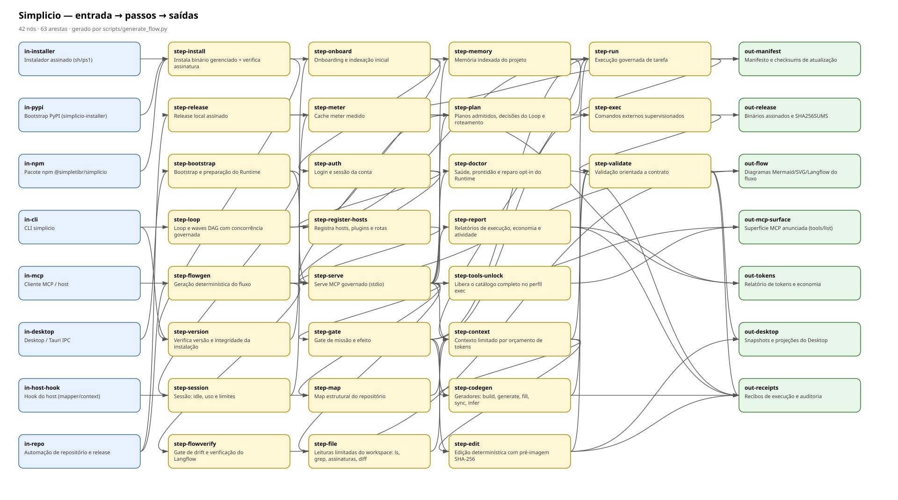

<div align="center">


<h1>Simplicio</h1>

<p><b>Same agent. Same model. Same task. 121&nbsp;s&nbsp;→&nbsp;25&nbsp;s, and $0.0226&nbsp;→&nbsp;$0.0076.</b></p>

<p>A local runtime that plugs into the coding agent you already use.</p>

<p>
  <a href="https://github.com/simpletibr/simplicio/releases/latest"></a>
  <a href="https://simpleti.com.br/simplicio/docs"></a>
  <a href="https://github.com/simpletibr/simplicio/stargazers"></a>
  
</p>

<p>
  English ·
  <a href="READMEs/README.pt-BR.md">Português (Brasil)</a> ·
  <a href="READMEs/README.es-ES.md">Español</a> ·
  <a href="READMEs/README.fr-FR.md">Français</a> ·
  <a href="READMEs/README.it-IT.md">Italiano</a> ·
  <a href="READMEs/README.pl-PL.md">Polski</a> ·
  <a href="READMEs/README.ru-RU.md">Русский</a> ·
  <a href="READMEs/README.zh-CN.md">简体中文</a> ·
  <a href="READMEs/README.ja-JP.md">日本語</a> ·
  <a href="READMEs/README.ko-KR.md">한국어</a> ·
  <a href="READMEs/README.hi-IN.md">हिन्दी</a> ·
  <a href="READMEs/README.ar-SA.md">العربية</a>&lrm; ·
  <a href="READMEs/README.he-IL.md">עברית</a>&lrm; ·
  <a href="READMEs/README.id-ID.md">Bahasa Indonesia</a> ·
  <a href="READMEs/README.ms-MY.md">Bahasa Melayu</a>
</p>

</div>

<p align="center">
  <picture>
    <source media="(prefers-color-scheme: dark)" srcset="assets/benchmark-2026-11-22-dark.svg">
    
  </picture>
</p>

<p align="center">
  <sub>Median of 3 sessions per setup. Claude Haiku 5.5 in Claude Code 2.1.330, 2026-11-22. Every setup delivered 9 of 9 steps. The thin line on each bar runs from the lowest to the highest session.<br>
  <a href="benchmarks/2026-11-22-standard-benchmark.md">Method, data and limits</a></sub>
</p>

> The recipe stays inside the binary. The measurements are public, including the ones we lose.

<p align="center">
  <b>Try it:</b> <a href="#install">Install</a> · <a href="#first-run">First run</a><br>
  <a href="#what-simplicio-is">What it is</a> ·
  <a href="#the-measurement">Measurement</a> ·
  <a href="#works-with-the-agent-you-already-use">Agents</a> ·
  <a href="#command-line">Commands</a> ·
  <a href="#safety-and-privacy">Privacy</a> ·
  <a href="#questions-people-ask">Questions</a> ·
  <a href="#documentation-and-community">Docs</a>
</p>

## What Simplicio is

Simplicio is a local runtime for coding agents.

- **You keep your agent and your model.** Simplicio does not replace Claude Code, Codex, Cursor or whatever model sits behind them.
- **You install one signed native binary.** The installer verifies the signature, then registers Simplicio in the agents it finds on your machine.
- **It runs on your machine.** Your agent starts it as a local STDIO MCP server. MCP is the Model Context Protocol, the standard way a coding agent calls outside tools. STDIO means the agent launches the program itself and talks to it through its standard input and output.
- **What changes is the session.** How long it takes and what it costs. The next section shows by how much, and where it does not help.

## The measurement

One job, run the same way with and without Simplicio. The job is one agent session with three steps in the same conversation:

1. Build a user listing: an API and a page with a table, search and sorting.
2. Change it: drop a column, add a filter by role and a date column.
3. Add a simple registration: a `POST` endpoint that checks its input, and a form page.

After every step the result is checked from outside the session. The API is called over HTTP and the pages are loaded in headless Chrome, which is Chrome without a window. Every setup used the same agent and the same model: Claude Code 2.1.330 with Claude Haiku 5.5. The baseline is that agent working with its own tools, with no Simplicio and no MCP server.

Median of 3 sessions per setup, with the lowest and highest session in brackets:

| Measure | No Simplicio | Simplicio 3.14.0 | Simplicio 3.15.0 |
|---|---|---|---|
| Time for the whole job | 121 s (97 to 172) | 104 s (90 to 106) | **25 s (23 to 27)** |
| Cost reported by the agent | $0.0226 (0.0186 to 0.0280) | $0.0220 (0.0214 to 0.0249) | **$0.0076 (0.0071 to 0.0098)** |
| Model requests | 25 (19 to 33) | 18 (18 to 22) | **10 (10 to 10)** |
| Tool calls | 22 (16 to 30) | 15 (15 to 19) | **7 (7 to 7)** |
| Output tokens | 18,162 (15,599 to 23,328) | 19,722 (18,764 to 24,997) | **3,211 (3,068 to 3,573)** |
| Input tokens | 34,691 (30,447 to 42,543) | 34,141 (33,121 to 40,017) | 18,755 (18,466 to 33,300) |
| CPU time | 8.5 s (8.5 to 9.2) | 10.0 s (8.9 to 10.0) | **5.3 s (5.3 to 5.5)** |
| Peak memory | **270 MB (248 to 274)** | 436 MB (432 to 439) | 375 MB (365 to 379) |
| Steps delivered | 9 of 9 | 9 of 9 | 9 of 9 |

Bold marks the best value in a row, only where its range does not overlap the others. The input-token ranges overlap, so this run claims no difference in input tokens. "9 of 9" is 3 steps in each of 3 sessions, and every step passed every outside check. A model request is one call to the model, and a tool call is one use of a tool by the agent. Cost is what the agent reports: the tokens served times the published price of the model. It is not an invoice.

By step, as numbered above. Each cell is the median time and the median cost:

| Step | No Simplicio | Simplicio 3.14.0 | Simplicio 3.15.0 |
|---|---|---|---|
| 1. Build | 57.3 s / $0.0111 | 53.7 s / $0.0137 | 5.8 s / $0.0022 |
| 2. Change | 17.3 s / $0.0040 | 15.2 s / $0.0032 | 8.9 s / $0.0023 |
| 3. Register | 31.4 s / $0.0075 | 27.5 s / $0.0056 | 10.3 s / $0.0026 |

**How to read it.** Against the same agent without Simplicio, the whole job ran 4.9 times faster and cost about a third as much. Against the previous release it ran 4.2 times faster. In the session, the model made 10 requests instead of 25 and wrote 3,211 output tokens instead of 18,162, for the same delivered result. The baseline is a competent, widely used agent working with its own tools. It is not handicapped. The sessions ran four at a time on one machine, so compare times only inside this table.

### Where Simplicio does not win

- **Memory.** Peak memory was 39% higher than with the plain agent: 375 MB against 270 MB.
- **The previous release did not pay for itself on this job.** Simplicio 3.14.0 cost the same as no Simplicio, and its time difference is inside the run-to-run spread. The gain on this page arrived with 3.15.0.
- **A short one-off Python script.** In an earlier round, Simplicio 3.10.8 was slower than the plain agent with every model tried. On Claude Sonnet 5.5 in Claude Code it took 19.6 s and $0.0548, against 11.4 s and $0.0283 without it. That task has not been measured again on 3.15.0.
- **The sample is small.** Three sessions per setup, one model, one small new project, one machine, four sessions at once. Read the ratios as a measurement of this job, not as a promise for yours.

### Check it yourself

The prompts, the outside checks and every per-session number are in [the report](benchmarks/2026-11-22-standard-benchmark.md) and in [the data file](benchmarks/2026-11-22-standard-benchmark.json). Run the same three prompts in your own agent with Simplicio on and off, in a small project of your own, and compare your own times and your own bill. Earlier published runs are in [`benchmarks/`](benchmarks/).

## Install

Install the signed native binary. Pick one path.

macOS / Linux:

```bash
curl -fsSL https://raw.githubusercontent.com/simpletibr/simplicio/master/install.sh | sh
```

Windows (PowerShell):

```powershell
irm https://raw.githubusercontent.com/simpletibr/simplicio/master/install.ps1 | iex
```

Python (PyPI):

```bash
python3 -m pip install --upgrade simplicio-installer
simplicio install
```

On Windows, use `py -m pip install --upgrade simplicio-installer` and then `simplicio install`. If the Python script directory is not on your `PATH`, add it first.

The installer downloads the latest signed release for your platform and checks its SHA-256 and its Ed25519 signature. Only then does it replace the installed binary. It puts the binary under `~/.simplicio/bin/` (on Windows, `%USERPROFILE%\.simplicio\bin\`) and automatically registers Simplicio in the agents it finds. A registration failure stops the installer instead of reporting success. Restart any agent that is already open so it reloads its configuration.

**Sign in.** A Google sign-in is required, including during the public beta. Run `simplicio auth login`, then `simplicio auth status --json`, and continue when the status reports `active: true`. Registration does not need you to be signed in, so the agents are configured even before you sign in. Never paste a password or token into an agent's configuration.

<details>
<summary>Check, update, remove</summary>

To update, run the installer again. Both installers are idempotent and resolve the latest release. `install.sh` and `install.ps1` are in the root of this repository.

```bash
# macOS / Linux
sh install.sh --doctor
sh install.sh --uninstall --keep-data
sh install.sh --uninstall --purge       # confirmation required; preserves ~/.simplicio/.env
```

```powershell
# Windows
pwsh install.ps1 -Doctor
pwsh install.ps1 -Uninstall -KeepData
pwsh install.ps1 -Uninstall -Purge      # confirmation required; preserves .env
```

- `--doctor` is a read-only health check.
- `--uninstall --keep-data` removes the installed binary and keeps your data. That includes the 30-day Google sign-in state in `~/.simplicio/login.json`.
- `--uninstall --purge` removes only the state Simplicio manages, the sign-in state included. It keeps `~/.simplicio/.env`, where provider credentials may live. An interactive purge asks you to type `PURGE`. For a non-interactive purge, set `SIMPLICIO_CONFIRM_PURGE=1`.
- Data inside a project's own `.simplicio` folder is not removed by `--keep-data`. Look at the target before you choose `--purge`.

Full details: [INSTALL.md](INSTALL.md).

</details>

## First run

```bash
simplicio version
cd my-project
simplicio onboard
```

`simplicio version` confirms the installed binary. `simplicio onboard` prepares the project the first time. Then open your agent in that project and work as usual.

## Works with the agent you already use

Simplicio is a local STDIO MCP server, so an agent that can start one can use it. The registry in [`plugins/simplicio/host-surfaces.json`](plugins/simplicio/host-surfaces.json) lists 43 host ids, grouped here by how Simplicio reaches them:

| How Simplicio reaches it | Agents |
|---|---|
| Native plugin or extension (5) | Claude Code, Codex, OpenCode, Hermes Agent, Gemini CLI |
| Portable plugin package (4) | Cursor, GitHub Copilot, Kiro, Qwen Code |
| MCP entry written by the Runtime (23) | xAI Grok Build, MiMo Code, Amp, OpenClaude, Antigravity, Pi, oh-my-pi, Goose, Auggie, Autohand Code, Charm, Cline, Command Code, Continue, Droid, Kilocode, Kimi, Mistral Vibe, Rovo Dev, Visual Studio Code, Meta Muse Code, OpenMausBot, OpenMuse |
| Guided setup, you follow the steps (9) | Devin, Codebuff, CopilotKit OpenDots, CopilotKit OpenBot, agentes.chat, OpenAI dots, xAI Grok Bot, Meta Muse app, Cue by Manus |
| Through another CLI (2) | OrcaDev / Orca ADE, T3 Code |

The 43 counts the host ids in that registry. It does not count products that were tested. Each host guide in [`docs/hosts/`](docs/hosts/) states what was verified and what was not, and the [compatibility matrix](docs/hosts/compatibility-matrix.md) shows what the installer does for each host.

To repeat the registration, run `simplicio mcp register`. The server command is `simplicio serve --mcp --stdio`. These are the tools your agent sees most:

| Tool | What it gives you |
|---|---|
| `simplicio_map` | A compact map of the repository, so the agent finds its way around |
| `simplicio_context` | The context a task needs, bounded, instead of whole files |
| `simplicio_edit` | Structured file edits, applied as described |
| `simplicio_validate` | Pipeline, test and delivery checks |
| `simplicio_run` | A task run under the Runtime's control |

The live list is whatever the server reports at startup. [MCP-CONNECT.md](MCP-CONNECT.md) has the full catalogue.

<details>
<summary>Manual configuration</summary>

Most agents are configured for you. If yours is not, add this entry to its MCP configuration. Replace the path with the absolute path of the installed binary.

```json
{
  "mcpServers": {
    "simplicio": {
      "command": "/absolute/path/to/.simplicio/bin/simplicio",
      "args": ["serve", "--mcp", "--stdio"]
    }
  }
}
```

Codex reads TOML. Agents start `command` directly, so do not use `~` and do not rely on shell expansion. Use forward slashes in Windows paths, and replace the example user name.

Windows:

```toml
[mcp_servers.simplicio]
command = "C:/Users/YourName/.simplicio/bin/simplicio.exe"
args = ["serve", "--mcp", "--stdio"]
```

macOS:

```toml
[mcp_servers.simplicio]
command = "/Users/your-name/.simplicio/bin/simplicio"
args = ["serve", "--mcp", "--stdio"]
```

Linux:

```toml
[mcp_servers.simplicio]
command = "/home/your-name/.simplicio/bin/simplicio"
args = ["serve", "--mcp", "--stdio"]
```

Where each agent keeps its file: [MCP-CONNECT.md](MCP-CONNECT.md).

</details>

## Command line

| Command | What you get |
|---|---|
| `simplicio map --repo . --for-llm markdown` | A compact structural map of the repository, written for a model to read |
| `simplicio context --repo .` | The bounded context for a task |
| `simplicio memory query "query" --json` | What the project already knows, recalled from its indexed memory, as JSON |
| `simplicio edit --plan plan.json --repo .` | A prepared set of structured edits, applied to the files |
| `simplicio run "task" --repo . --agents N` | A task run with N agents under the Runtime's control |
| `simplicio loop` | Work that goes on in rounds until it converges |

The public vocabulary: Mapper observes, Fast projects or retrieves, Dev CLI edits, Runtime governs, and Loop converges.

## Safety and privacy

This section describes version 3.15.0.

**What Simplicio sends, and to whom**

- **Your machine.** Mapping, context, edits and checks run on your machine, inside the Simplicio binary. Simplicio hands its results to your agent on the same machine. What your agent then sends to its own model provider is decided by the agent, as before.
- **SimpleTI (simpleti.com.br).** Sign-in and plan checks only. They identify your account and this machine: a sign-in token, the program version and the machine's host name as a device name. They return your account e-mail, name and plan. None of them carries repository content: no files, no file paths, no prompts and no edits.
- **GitHub.** A background check for a new release, at most about once every 12 hours. It carries no data about you or your code. Set `SIMPLICIO_DISABLE_AUTO_UPDATE=1` to turn it off. A new version is downloaded with a SHA-256 check and a signature check.
- **Analytics and crash reports.** The 3.15.0 source has no analytics, crash-report or usage upload. Usage and savings records are written to local files.
- **Services you choose.** Your code goes to another service only when you point Simplicio at one yourself: a model provider you configure for a task you ask Simplicio to run, or an integration you set up, for example GitHub or Jira. It goes to the service you chose, not to SimpleTI.

**Signed releases.** Each release publishes its binaries with SHA-256 checksums, Ed25519 signatures, an SBOM (a list of what is in the build) and build provenance. The installers and the update path check the checksum and the signature before they replace the installed binary. A missing or invalid signature and a checksum mismatch are hard failures. The contract is in [docs/UPDATE_SIGNATURE_CONTRACT.md](docs/UPDATE_SIGNATURE_CONTRACT.md).

**What the installer changes in your agent.** It adds a Simplicio entry to the agent's MCP configuration and keeps the rest of the configuration. In Claude Code it also allows `mcp__simplicio__*`, so a Simplicio tool is not denied in auto mode. Uninstall removes only the entries the installer wrote.

## Also in this repository

<details>
<summary>Desktop app (macOS preview)</summary>

A macOS (Apple Silicon) Desktop preview is published as [Simplicio-3.8.47-arm64.dmg](https://github.com/simpletibr/simplicio/releases/download/v3.8.47/Simplicio-3.8.47-arm64.dmg). Its SHA-256 is in [DESKTOP-SHA256SUMS](DESKTOP-SHA256SUMS), separate from the Runtime checksums.

- Windows Desktop is not published. On Windows, use the command-line install above.
- Apple Developer ID signing and notarization are not done. The package is ad-hoc signed, which means without an Apple developer certificate, and Gatekeeper acceptance is not claimed.
- The command-line install above is the supported public installation path until a signed Desktop package is published.

Details: [docs/desktop/RELEASE.md](docs/desktop/RELEASE.md).

</details>

<details>
<summary>Map of the public surface</summary>



The flow has 8 inputs, 27 steps and 7 outputs (42 nodes, 63 edges). It covers every public command of the command line and the 13 MCP tools documented in [MCP-CONNECT.md](MCP-CONNECT.md). It is generated from one source file, `docs/flow/simplicio.flow.json`:

```bash
python3 scripts/generate_flow.py            # regenerate the Mermaid, SVG and Langflow files
python3 scripts/generate_flow.py --check    # drift check before a release
python3 -m pytest tests/test_flow_contract.py -q
```

The generated files are `simplicio.mmd`, `simplicio.svg` and `langflow/simplicio.langflow.json`. The Mermaid render was checked with `mmdc`; the evidence and hashes are in `docs/flow/render/`. The current artifact was imported into Langflow 1.12.0 on a local server on 2026-11-21 and read back. The receipt is `docs/flow/evidence/langflow-verify.json` and the read-back is `docs/flow/evidence/langflow-readback.json`. Without a server, `scripts/verify_flow_langflow.py` fails closed (exit 2, `status=blocked`). Requirements and how to repeat it: [docs/flow/README.md](docs/flow/README.md).

</details>

## Questions people ask

**Do I have to change my agent or my model?**<br>
No. Simplicio plugs into the agent you already use. In the benchmark above, every setup used the same agent and the same model.

**Will I always get these numbers?**<br>
No. They measure one job, with one model, on one machine, over three sessions per setup. See [Where Simplicio does not win](#where-simplicio-does-not-win), and run the comparison on your own work.

**Is it open source?**<br>
No. Simplicio is proprietary. The Runtime is a signed binary, published as release assets, and its source is not public. This repository holds the installers, the packages for the agents, the Desktop app source, the documentation and the benchmark data.

**How do I remove it?**<br>
Run `sh install.sh --uninstall --keep-data`, or `pwsh install.ps1 -Uninstall -KeepData` on Windows. It removes the binary and keeps your data. [Install](#install) has the details and the purge option.

**Do I need an account?**<br>
Yes. A Google sign-in is required, including during the public beta. Run `simplicio auth login`.

**Does my code leave my machine?**<br>
Mapping, context, edits and checks run on your machine. Simplicio talks to SimpleTI for sign-in and plan checks, and to GitHub to look for updates, with no repository content in either. See [What Simplicio sends, and to whom](#safety-and-privacy).

## Documentation and community

- **Website:** [simpleti.com.br/simplicio](https://simpleti.com.br/simplicio/)
- **Documentation:** [simpleti.com.br/simplicio/docs](https://simpleti.com.br/simplicio/docs)
- **Discord:** [Join the community](https://discord.gg/wM6tr7xVb)
- **Issues:** [GitHub issue tracker](https://github.com/simpletibr/simplicio/issues)
- **In this repository:** [INSTALL.md](INSTALL.md), [MCP-CONNECT.md](MCP-CONNECT.md), [docs/hosts/](docs/hosts/) and [benchmarks/](benchmarks/)
- **Related:** Simplicio Video (hypit). To clone it: `git clone https://github.com/hypit-ai/hypit.git simplicio-video`

<p align="center">
  <sub>© 2026 SimpleTI. Simplicio is a registered proprietary software. All rights reserved.</sub>
</p>
