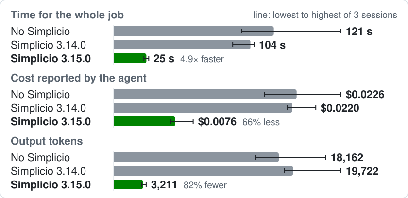

<div align="center">


<h1>Simplicio</h1>

<p><b>UltraFast Mode for all.</b></p>

<p><b>Même agent, même modèle, même tâche : 121&nbsp;s&nbsp;→&nbsp;25&nbsp;s, et $0.0226&nbsp;→&nbsp;$0.0076.</b></p>

<p>Sans Simplicio → avec Simplicio 3.15.0. Médiane de 3 exécutions d'une petite tâche de codage dans Claude Code, avec Claude Haiku 5.5.</p>

<p>Simplicio tourne sur votre machine et ajoute des outils à l'agent de codage que vous utilisez déjà.</p>

<p>
  <a href="https://github.com/simpletibr/simplicio/releases/latest"></a>
  <a href="https://simpleti.com.br/simplicio/docs"></a>
  <a href="https://github.com/simpletibr/simplicio/stargazers"></a>
  
</p>

<p>
  <a href="../README.md">English</a> ·
  <a href="README.pt-BR.md">Português (Brasil)</a> ·
  <a href="README.es-ES.md">Español</a> ·
  Français ·
  <a href="README.it-IT.md">Italiano</a> ·
  <a href="README.pl-PL.md">Polski</a> ·
  <a href="README.ru-RU.md">Русский</a> ·
  <a href="README.zh-CN.md">简体中文</a> ·
  <a href="README.ja-JP.md">日本語</a> ·
  <a href="README.ko-KR.md">한국어</a> ·
  <a href="README.hi-IN.md">हिन्दी</a> ·
  <a href="README.ar-SA.md">العربية</a>&lrm; ·
  <a href="README.he-IL.md">עברית</a>&lrm; ·
  <a href="README.id-ID.md">Bahasa Indonesia</a> ·
  <a href="README.ms-MY.md">Bahasa Melayu</a>
</p>

<p align="center"><sub>Ce fichier est une traduction du <a href="../README.md">README en anglais</a>. En cas de différence, la page anglaise fait foi. Les graphiques sont en anglais.</sub></p>

</div>

<p align="center">
  <picture>
    <source media="(prefers-color-scheme: dark)" srcset="../assets/benchmark-2026-11-22-dark.svg">
    
  </picture>
</p>

<p align="center">
  <sub>Médiane de 3 sessions pour chaque configuration (sans Simplicio, Simplicio 3.14.0 et Simplicio 3.15.0). Claude Haiku 5.5 dans Claude Code 2.1.330, 2026-11-22. Chaque configuration a livré 9 étapes sur 9. La fine ligne sur chaque barre va de la session la plus basse à la session la plus haute.<br>
  <a href="../benchmarks/2026-11-22-standard-benchmark.md">Méthode, données et limites</a></sub>
</p>

<p align="center">
  <sub>À lire avec ces chiffres : une petite tâche, trois sessions par configuration, un seul modèle. Les vérifications externes sont plus étroites que les prompts. Le pic de mémoire était plus élevé : 375 MB contre 270 MB. Les builds de Simplicio ont été compilés à partir des commits de version, avec la connexion à un compte désactivée.</sub>
</p>

<p align="center">La manière dont Simplicio obtient ce résultat n'est pas publiée. Les mesures le sont, y compris celles où il perd.</p>

<p align="center">
  <b>Essayer :</b> <a href="#install">Installation</a> · <a href="#first-run">Premier lancement</a><br>
  <a href="#what-simplicio-is">Présentation</a> ·
  <a href="#the-measurement">Mesure</a> ·
  <a href="#works-with-the-agent-you-already-use">Agents</a> ·
  <a href="#command-line">Commandes</a> ·
  <a href="#safety-and-privacy">Confidentialité</a> ·
  <a href="#questions-people-ask">Questions</a> ·
  <a href="#documentation-and-community">Documentation</a>
</p>

<a id="what-simplicio-is"></a>

## Ce qu'est Simplicio

Simplicio est un programme local qui donne à l'agent de codage que vous utilisez déjà un mode ultra-rapide, quel que soit l'agent et quel que soit le modèle. Les chiffres de cette page viennent d'un seul agent et d'un seul modèle ; la section ci-dessous dit exactement ce qui a été mesuré.

- **Vous gardez votre agent et votre modèle.** Simplicio ne remplace pas Claude Code, Codex, Cursor ni le modèle qui se trouve derrière eux.
- **Un seul binaire signé** s'enregistre dans vos agents et tourne sur votre machine comme serveur MCP local en STDIO.
- **Ce qui change, c'est la session.** Sa durée et son coût.

<p align="center">
  <picture>
    <source media="(prefers-color-scheme: dark)" srcset="../assets/diagram-where-simplicio-runs-dark.svg">
    
  </picture>
</p>

<p align="center">
  <sub>Le flux par défaut. <a href="#safety-and-privacy">La liste complète</a> recense les autres services.</sub>
</p>

<details>
<summary>MCP et STDIO</summary>

MCP est le Model Context Protocol, la méthode standard qu'un agent de codage utilise pour appeler des outils externes. STDIO signifie que l'agent lance lui-même le programme et lui parle par son entrée et sa sortie standard.

Il donne des outils à votre agent. Une carte du dépôt, un contexte borné, des modifications structurées et des vérifications. [Les outils principaux](#works-with-the-agent-you-already-use) sont listés plus bas.

Vous installez un seul binaire natif signé. L'installateur vérifie la signature, puis enregistre Simplicio dans les agents qu'il trouve sur votre machine.

</details>

<a id="the-measurement"></a>

## La mesure

Une tâche, exécutée de la même façon avec et sans Simplicio : trois étapes dans une même session d'agent, et chaque résultat est vérifié depuis l'extérieur.

1. Construire une liste d'utilisateurs : une API et une page avec un tableau, une recherche et un tri.
2. La modifier : supprimer une colonne, ajouter un filtre par rôle et une colonne de date.
3. Ajouter une inscription : un point de terminaison `POST` qui vérifie ses entrées, et une page de formulaire.

<p align="center">
  <picture>
    <source media="(prefers-color-scheme: dark)" srcset="../assets/benchmark-2026-11-22-sessions-dark.svg">
    
  </picture>
</p>

| Mesure | Sans Simplicio | Simplicio 3.14.0 | Simplicio 3.15.0 |
|---|---|---|---|
| Durée de la tâche | 121 s<br><sub>97–172</sub> | 104 s<br><sub>90–106</sub> | **25 s**<br><sub>23–27</sub> |
| Coût indiqué | $0.0226<br><sub>0.0186–0.0280</sub> | $0.0220<br><sub>0.0214–0.0249</sub> | **$0.0076**<br><sub>0.0071–0.0098</sub> |
| Requêtes au modèle | 25<br><sub>19–33</sub> | 18<br><sub>18–22</sub> | **10**<br><sub>10–10</sub> |
| Appels d'outils | 22<br><sub>16–30</sub> | 15<br><sub>15–19</sub> | **7**<br><sub>7–7</sub> |
| Tokens de sortie | 18,162<br><sub>15,599–23,328</sub> | 19,722<br><sub>18,764–24,997</sub> | **3,211**<br><sub>3,068–3,573</sub> |
| Tokens d'entrée | 34,691<br><sub>30,447–42,543</sub> | 34,141<br><sub>33,121–40,017</sub> | 18,755<br><sub>18,466–33,300</sub> |
| Temps CPU | 8.5 s<br><sub>8.5–9.2</sub> | 10.0 s<br><sub>8.9–10.0</sub> | **5.3 s**<br><sub>5.3–5.5</sub> |
| Pic de mémoire | **270 MB**<br><sub>248–274</sub> | 436 MB<br><sub>432–439</sub> | 375 MB<br><sub>365–379</sub> |
| Étapes livrées | 9 sur 9 | 9 sur 9 | 9 sur 9 |

Médiane de 3 sessions, de la plus basse à la plus haute sous chaque valeur. En gras, la meilleure valeur d'une ligne, lorsque les plages ne se chevauchent pas. « 9 sur 9 » correspond à 3 étapes dans chacune des 3 sessions, toutes réussies à chaque vérification externe.

Requêtes et appels d'outils par session.

<p align="center">
  <picture>
    <source media="(prefers-color-scheme: dark)" srcset="../assets/benchmark-2026-11-22-work-dark.svg">
    
  </picture>
</p>

Durée par étape, sur une échelle commune.

<p align="center">
  <picture>
    <source media="(prefers-color-scheme: dark)" srcset="../assets/benchmark-2026-11-22-steps-dark.svg">
    
  </picture>
</p>

<details>
<summary>Chiffres exacts par étape</summary>

Chaque cellule indique la durée médiane et le coût médian de l'étape :

| Étape | Sans Simplicio | Simplicio 3.14.0 | Simplicio 3.15.0 |
|---|---|---|---|
| 1. Construction | 57.3 s / $0.0111 | 53.7 s / $0.0137 | 5.8 s / $0.0022 |
| 2. Modification | 17.3 s / $0.0040 | 15.2 s / $0.0032 | 8.9 s / $0.0023 |
| 3. Inscription | 31.4 s / $0.0075 | 27.5 s / $0.0056 | 10.3 s / $0.0026 |

</details>

**Comment le lire.** La tâche entière a tourné 4.9 fois plus vite, pour environ un tiers du coût ; même la session la plus rapide sans Simplicio (97.1 s) était 3.7 fois plus lente que la plus lente avec 3.15.0 (26.6 s). [Méthode, limites](../benchmarks/2026-11-22-standard-benchmark.md#limits)

<details>
<summary>Comment chaque chiffre est défini</summary>

- Les ratios viennent des médianes non arrondies. Face à la version précédente, la tâche entière a tourné 4.2 fois plus vite.
- Chaque médiane est calculée séparément : les étapes ne s'additionnent donc pas jusqu'à la médiane de la tâche entière.
- Cas le plus défavorable : la session la plus rapide sans Simplicio (97.1 s) était encore 3.7 fois plus lente que la session la plus lente avec Simplicio 3.15.0 (26.6 s), et la session la moins chère sans lui ($0.0186) coûtait encore 1.9 fois plus que la session la plus chère avec lui ($0.0098).
- La référence est Claude Code 2.1.330 avec ses propres outils, sans serveur MCP et sans configuration de Simplicio.
- Chaque étape est vérifiée depuis l'extérieur de la session : l'API est appelée en HTTP, et les pages sont chargées dans Chrome headless, c'est-à-dire Chrome sans fenêtre.
- Les vérifications ne testent ni la zone de recherche, ni le tri, ni la redirection après l'enregistrement, ni l'aspect de la page, ni la qualité du code.
- Une requête au modèle est un appel au modèle ; un appel d'outil est une utilisation d'outil par l'agent.
- Le coût indiqué est le nombre de tokens utilisés multiplié par le prix publié du modèle. Il ne compte que les tokens du modèle. Ce n'est pas une facture.
- Les plages des tokens d'entrée se chevauchent : cette série ne revendique donc aucune différence sur les tokens d'entrée.
- Quatre sessions tournaient en même temps sur une machine : ne comparez les durées qu'au sein de cette série.

</details>

<a id="where-simplicio-does-not-win"></a>

### Là où Simplicio ne gagne pas

<p align="center">
  <picture>
    <source media="(prefers-color-scheme: dark)" srcset="../assets/benchmark-2026-11-22-memory-dark.svg">
    
  </picture>
</p>

- **Mémoire.** Le pic de mémoire était supérieur de 39% : 375 MB contre 270 MB.
- **La version précédente n'a montré aucun gain sur cette tâche.** Simplicio 3.14.0 a coûté autant que sans Simplicio.
- **Un petit script Python ponctuel.** Simplicio 3.10.8 a été plus lent (19.6 s contre 11.4 s) et n'a pas été mesuré de nouveau.
- **Ce que vous installez n'est pas exactement ce qui a été mesuré.** Les builds ont été compilés à partir des commits de version, avec la connexion à un compte désactivée.
- **L'échantillon est petit.** Trois sessions par configuration, un seul modèle, un seul projet.

<details>
<summary>Les limites complètes</summary>

- **Mémoire.** Le pic de mémoire était supérieur de 39% à celui de l'agent sans Simplicio : 375 MB contre 270 MB.
- **La version précédente n'a montré aucun gain sur cette tâche.** Simplicio 3.14.0 a coûté autant que sans Simplicio, et son écart de durée se situe dans la dispersion d'une exécution à l'autre. Le gain est apparu avec 3.15.0.
- **Un petit script Python ponctuel.** Lors d'une série antérieure, Simplicio 3.10.8 a été plus lent que l'agent sans Simplicio avec chaque modèle essayé : avec Claude Sonnet 5.5 dans Claude Code, 19.6 s et $0.0548 contre 11.4 s et $0.0283. Non mesuré de nouveau avec 3.15.0.
- **Ce que vous installez n'est pas exactement ce qui a été mesuré.** Les builds ont été compilés à partir des commits de version, avec la connexion à un compte et le processus d'arrière-plan désactivés. Les téléchargements signés n'ont pas été mesurés.
- **L'échantillon est petit.** Trois sessions par configuration, un seul modèle, un petit projet neuf, une seule machine, quatre sessions à la fois ; aucune n'a été écartée ni relancée. Les ratios mesurent cette tâche, pas la vôtre, et nous n'avons pas mesuré la part de votre travail qui lui ressemble.

</details>

### Vérifiez vous-même

[Le rapport](../benchmarks/2026-11-22-standard-benchmark.md) publie les trois prompts (en portugais, avec une traduction), chaque vérification externe et chaque session ; [le fichier de données](../benchmarks/2026-11-22-standard-benchmark.json) les contient au format JSON. Le harnais de test n'est pas publié.

<a id="install"></a>

## Installation

macOS / Linux :

```bash
curl -fsSL https://raw.githubusercontent.com/simpletibr/simplicio/master/install.sh | sh
```

Windows (PowerShell) :

```powershell
irm https://raw.githubusercontent.com/simpletibr/simplicio/master/install.ps1 | iex
```

Python (PyPI) :

```bash
python3 -m pip install --upgrade simplicio-installer
simplicio install
```

Sous Windows, utilisez `py -m pip install --upgrade simplicio-installer`, puis `simplicio install`.

L'installateur vérifie la version signée et enregistre automatiquement Simplicio dans les agents qu'il trouve. Connectez-vous ensuite avec `simplicio auth login`.

<details>
<summary>Détails de l'installation</summary>

- Il télécharge la dernière version signée pour votre plateforme et vérifie son SHA-256 et sa signature Ed25519 avant de remplacer le binaire installé.
- Le binaire est placé sous `~/.simplicio/bin/` (sous Windows, `%USERPROFILE%\.simplicio\bin\`), et Simplicio est enregistré automatiquement dans les agents trouvés. Un échec d'enregistrement arrête l'installateur au lieu d'annoncer un succès.
- Redémarrez tout agent déjà ouvert pour qu'il recharge sa configuration. Si le répertoire des scripts Python n'est pas dans votre `PATH`, ajoutez-le d'abord.

**Connexion.** Une connexion Google est requise, y compris pendant la bêta. Lancez `simplicio auth login`, puis `simplicio auth status --json`, et poursuivez lorsque le statut indique `active: true`. L'enregistrement fonctionne avant même votre connexion. Ne collez jamais un mot de passe ni un jeton dans la configuration d'un agent.

Pour vérifier que Simplicio est chargé, cherchez `simplicio` dans la liste des serveurs MCP de l'agent. Dans Claude Code, `/mcp` affiche les serveurs connectés. Vous préférez lire d'abord l'installateur ? Il s'agit de [install.sh](../install.sh).

Pour mettre à jour, relancez l'un ou l'autre installateur à tout moment : il identifie la dernière version. `install.sh` et `install.ps1` se trouvent à la racine de ce dépôt.

```bash
# macOS / Linux
sh install.sh --doctor
sh install.sh --uninstall --keep-data
sh install.sh --uninstall --purge       # needs SIMPLICIO_CONFIRM_PURGE=1; preserves ~/.simplicio/.env
```

```powershell
# Windows
pwsh install.ps1 -Doctor
pwsh install.ps1 -Uninstall -KeepData
pwsh install.ps1 -Uninstall -Purge      # needs SIMPLICIO_CONFIRM_PURGE=1; preserves .env
```

- `--doctor` vérifie l'installation.
- `--uninstall --keep-data` supprime le binaire installé et conserve vos données. Cela inclut l'état de connexion Google valable 30 jours, dans `~/.simplicio/login.json`.
- `--uninstall --purge` supprime uniquement l'état géré par Simplicio, y compris l'état de connexion. Il conserve `~/.simplicio/.env`, où peuvent se trouver les identifiants des fournisseurs. Une purge exige `SIMPLICIO_CONFIRM_PURGE=1`.
- La désinstallation ne modifie pas la configuration de vos agents. Les entrées Simplicio restent dans chaque agent tant que vous ne les supprimez pas dans ses propres réglages.
- Les données du dossier `.simplicio` propre à un projet ne sont pas supprimées par `--keep-data`. Vérifiez la cible avant de choisir `--purge`.

Détails complets : [INSTALL.md](../INSTALL.md).

</details>

<a id="first-run"></a>

## Premier lancement

```bash
simplicio version
cd my-project
simplicio onboard
```

`simplicio version` vérifie l'installation ; `simplicio onboard` prépare le projet. Ouvrez ensuite votre agent dans ce projet.

<a id="works-with-the-agent-you-already-use"></a>

## Compatible avec l'agent que vous utilisez déjà

L'installateur confie l'enregistrement à l'outil d'enregistrement propre à Simplicio. Il écrit l'entrée Simplicio pour les agents qu'il sait configurer, parmi lesquels Claude Code, Codex, Cursor, Visual Studio Code, OpenCode, Gemini CLI et Kiro.

Le registre [`plugins/simplicio/host-surfaces.json`](../plugins/simplicio/host-surfaces.json) recense 43 identifiants d'agents ; la matrice [`docs/hosts/compatibility-matrix.md`](../docs/hosts/compatibility-matrix.md) en marque 12 comme pris en charge et 29 comme `unverified`. Traitez une intégration `unverified` comme non testée.

<details>
<summary>Les 43 agents</summary>

- Le registre recense 43 identifiants d'agents et indique comment Simplicio atteint chacun : une entrée MCP que Simplicio écrit (23), un plugin ou une extension natif (5), un paquet de plugin portable (4), une configuration guidée que vous suivez vous-même (9), ou un autre outil en ligne de commande (2).
- La matrice n'a pas de ligne pour Codex ni pour Gemini CLI. Même lorsque le registre indique que Simplicio écrit l'entrée, traitez une intégration `unverified` comme non testée.
- 23 agents ont un guide dans [`docs/hosts/`](../docs/hosts/). Pour les agents atteints par un plugin, le plugin est appliqué dans une étape distincte qui demande votre accord, et [INSTALL.md](../INSTALL.md) la décrit.

| Comment Simplicio l'atteint | Nombre | Agents |
|---|---|---|
| Une entrée MCP écrite par Simplicio | 23 | **xAI Grok Build**, MiMo Code, Amp, OpenClaude, Antigravity, **Pi**, **oh-my-pi**, Goose, Auggie, Autohand Code, Charm, Cline, Command Code, Continue, Droid, Kilocode, Kimi, Mistral Vibe, Rovo Dev, **Visual Studio Code**, **Meta Muse Code**, **OpenMausBot**, **OpenMuse (Python)** |
| Un plugin ou une extension natif | 5 | **Claude Code**, Codex, **OpenCode**, Hermes Agent, Gemini CLI |
| Un paquet de plugin portable | 4 | **Cursor**, GitHub Copilot, **Kiro**, Qwen Code |
| Une configuration guidée que vous suivez vous-même | 9 | Devin, Codebuff, CopilotKit OpenDots, CopilotKit OpenBot, agentes.chat, OpenAI dots, xAI Grok Bot, Meta Muse app, Cue by Manus |
| Un autre outil en ligne de commande | 2 | **OrcaDev / Orca ADE**, T3 Code |

En gras : la matrice de compatibilité marque l'agent comme pris en charge.

</details>

Voici les outils de base que votre agent reçoit :

| Outil | Ce qu'il vous apporte |
|---|---|
| `simplicio_map` | Une carte compacte du dépôt, pour que l'agent s'y repère |
| `simplicio_context` | Le contexte dont une tâche a besoin, borné, au lieu de fichiers entiers |
| `simplicio_edit` | Modifications structurées de fichiers, à partir d'un plan préparé |
| `simplicio_validate` | Vérifications du pipeline, des tests et de la livraison |
| `simplicio_run` | Une exécution de tâche sous le contrôle de Simplicio |

[MCP-CONNECT.md](../MCP-CONNECT.md) décrit les outils de base.

<details>
<summary>Configuration manuelle</summary>

Simplicio est un serveur MCP local en STDIO : tout agent capable de lancer un serveur MCP local peut donc être configuré pour l'utiliser. Pour refaire l'enregistrement, lancez `simplicio mcp register`. La commande du serveur est `simplicio serve --mcp --stdio`.

Si votre agent n'a pas été configuré pour vous, ajoutez cette entrée à sa configuration MCP. Remplacez le chemin par le chemin absolu du binaire installé.

```json
{
  "mcpServers": {
    "simplicio": {
      "command": "/absolute/path/to/.simplicio/bin/simplicio",
      "args": ["serve", "--mcp", "--stdio"]
    }
  }
}
```

Codex lit du TOML. Les agents lancent `command` directement : n'utilisez donc pas `~` et ne comptez pas sur l'expansion du shell. Utilisez des barres obliques dans les chemins Windows, et remplacez le nom d'utilisateur de l'exemple.

Windows :

```toml
[mcp_servers.simplicio]
command = "C:/Users/YourName/.simplicio/bin/simplicio.exe"
args = ["serve", "--mcp", "--stdio"]
```

macOS :

```toml
[mcp_servers.simplicio]
command = "/Users/your-name/.simplicio/bin/simplicio"
args = ["serve", "--mcp", "--stdio"]
```

Linux :

```toml
[mcp_servers.simplicio]
command = "/home/your-name/.simplicio/bin/simplicio"
args = ["serve", "--mcp", "--stdio"]
```

Emplacement du fichier de chaque agent : [MCP-CONNECT.md](../MCP-CONNECT.md).

</details>

<a id="command-line"></a>

## Ligne de commande

| Commande | Ce que vous obtenez |
|---|---|
| `simplicio map --repo . --for-llm markdown` | Une carte structurelle compacte du dépôt, écrite pour être lue par un modèle |
| `simplicio context --repo .` | Le contexte borné d'une tâche |
| `simplicio memory query "query" --json` | Ce que le projet connaît déjà, rappelé depuis sa mémoire indexée, au format JSON |
| `simplicio edit --plan plan.json --repo .` | Un ensemble préparé de modifications structurées, appliqué aux fichiers |
| `simplicio run "task" --repo . --agents N` | Une exécution de tâche avec N agents sous le contrôle de Simplicio |
| `simplicio loop` | Un travail qui se poursuit par tours jusqu'à convergence |

Les noms que vous verrez dans les messages de Simplicio : Mapper observe, Fast projette ou récupère, Dev CLI modifie, Runtime gouverne et Loop fait converger.

<a id="safety-and-privacy"></a>

## Sécurité et confidentialité

Cette section décrit la version 3.15.0.

- **Reste sur votre machine.** La cartographie, le contexte, les modifications et les vérifications s'exécutent dans le binaire Simplicio.
- **Vers SimpleTI (simpleti.com.br).** Connexion et vérifications du forfait uniquement, sans contenu de dépôt.
- **Vers GitHub.** Une vérification de version que vous pouvez désactiver.
- **Pas d'analytics.** Simplicio n'envoie ni analytics, ni rapport de plantage, ni donnée d'usage.
- **Vers les services que vous configurez.** Ils reçoivent ce qu'envoie cette fonction, ce qui peut inclure des prompts et du code.
- **Deux fonctions atteignent un service ouvert au public sur Internet sans aucune configuration.** La recherche web (DuckDuckGo) et l'audit des dépendances (osv.dev) ; aucune des deux n'envoie le contenu des fichiers.
- **Téléchargements.** Depuis GitHub ; certains scripts auxiliaires récupèrent aussi leurs outils depuis PyPI ou npm.

<details>
<summary>Les détails</summary>

- **Reste sur votre machine.** La cartographie, le contexte, les modifications et les vérifications s'exécutent dans le binaire Simplicio. Il remet les résultats à votre agent, sur la même machine. Les relevés d'usage et d'économies sont des fichiers locaux. Ce que votre agent envoie à son propre fournisseur de modèle est décidé par l'agent, comme avant.
- **Vers SimpleTI (simpleti.com.br).** Connexion et vérifications du forfait uniquement, sans contenu de dépôt : ni fichiers, ni chemins de fichiers, ni prompts, ni modifications.
  - Elles transportent votre jeton de connexion, la version de Simplicio et le nom d'hôte de votre ordinateur. Une recherche de licence facultative transporte aussi l'adresse e-mail de votre compte.
  - Elles renvoient l'adresse e-mail, le nom et le forfait de votre compte.
- **Vers GitHub.** Une vérification en arrière-plan de nouvelle version, au plus environ une fois toutes les 12 heures, sans rien transporter sur vous ni sur votre code. Définissez `SIMPLICIO_DISABLE_AUTO_UPDATE=1` pour la désactiver. Une mise à jour télécharge le binaire depuis GitHub, et son SHA-256 et sa signature sont vérifiés avant qu'il remplace l'ancien.
- **Pas d'analytics.** Simplicio 3.15.0 et les fichiers installés dans vos agents ont été vérifiés sur ce point : aucun n'envoie d'analytics, de rapports de plantage ni de données d'usage. Les hooks installés ne lancent que des programmes locaux (le binaire Simplicio et, pour les plugins facultatifs, des scripts locaux) ; aucun ne contacte le réseau.
- **Vers les services que vous configurez.** Un fournisseur de modèle, GitHub, Jira, un service de notifications de chat ou un cache d'équipe reçoivent ce qu'envoie cette fonction, ce qui peut inclure des prompts et du code. Les requêtes vers un fournisseur de modèle portent un en-tête qui désigne Simplicio comme client.
- **Deux fonctions atteignent un service ouvert au public sur Internet sans aucune configuration.** Ni l'une ni l'autre n'envoie le contenu des fichiers.
  - La recherche web, quand elle s'exécute, envoie la requête à DuckDuckGo, sauf si vous configurez un autre service de recherche. Dans le chat propre à Simplicio, un message qui ressemble à une question sur le web peut devenir cette requête.
  - L'audit de sécurité des dépendances, quand vous le lancez, envoie à osv.dev les noms et les versions de vos dépendances.
- **Téléchargements.** L'installateur et le chemin de mise à jour téléchargent depuis GitHub. Certains scripts auxiliaires facultatifs récupèrent leurs propres outils depuis PyPI ou npm lorsque vous les lancez. Un plugin d'agent qui ne trouve aucun binaire Simplicio télécharge l'installateur officiel depuis GitHub, épinglé à un commit et vérifié par SHA-256.

**Versions signées.** Chaque version publie ses binaires avec leurs sommes SHA-256, leurs signatures Ed25519, une SBOM (liste de ce qui compose le build) et la provenance du build.

Les installateurs et le chemin de mise à jour vérifient la somme de contrôle et la signature avant de remplacer le binaire installé. Pour les versions stables, une signature absente ou invalide et une somme de contrôle qui ne correspond pas sont des échecs bloquants ; le contrat se trouve dans [docs/UPDATE_SIGNATURE_CONTRACT.md](../docs/UPDATE_SIGNATURE_CONTRACT.md).

**Ce que l'installateur modifie dans votre agent.**

- Il ajoute une entrée Simplicio à la configuration MCP de l'agent et conserve le reste de la configuration.
- Dans Claude Code, il autorise aussi `mcp__simplicio__*`, afin qu'un outil Simplicio ne soit pas refusé en mode automatique.
- Dans les agents dont l'interface de hooks a été vérifiée par l'installateur, il installe aussi les hooks de Simplicio.
- La désinstallation n'annule pas ces entrées ; la section Installation indique comment les supprimer. [INSTALL.md](../INSTALL.md) décrit ce que l'installateur écrit, et le guide de chaque agent dans [`docs/hosts/`](../docs/hosts/) donne le détail.

</details>

## Également dans ce dépôt

<details>
<summary>Application de bureau (aperçu macOS)</summary>

Un aperçu de l'application de bureau pour macOS (Apple Silicon) est publié sous forme de [Simplicio-3.8.47-arm64.dmg](https://github.com/simpletibr/simplicio/releases/download/v3.8.47/Simplicio-3.8.47-arm64.dmg). Son SHA-256 figure dans [DESKTOP-SHA256SUMS](../DESKTOP-SHA256SUMS), distinct des sommes de contrôle des binaires Simplicio. Le DMG n'a pas de fichier de signature et contient le binaire Simplicio 3.8.47.

- L'application de bureau pour Windows n'est pas publiée. Sous Windows, utilisez l'installation en ligne de commande ci-dessus.
- La signature Apple Developer ID et la notarisation ne sont pas faites. Le paquet est signé ad hoc, c'est-à-dire sans certificat de développeur Apple, et l'acceptation par Gatekeeper n'est pas garantie : macOS peut donc vous avertir à l'ouverture.
- L'installation en ligne de commande ci-dessus reste la méthode d'installation publique prise en charge tant qu'un paquet de bureau signé n'est pas publié.

Détails : [docs/desktop/RELEASE.md](../docs/desktop/RELEASE.md).

</details>

<details>
<summary>Pour les mainteneurs : le diagramme de flux généré</summary>

- Les commandes et outils documentés dans README.md et MCP-CONNECT.md sont représentés par un seul flux, [docs/flow/simplicio.svg](../docs/flow/simplicio.svg), généré à partir d'un seul fichier source, `docs/flow/simplicio.flow.json`.
- Régénérez-le avec `python3 scripts/generate_flow.py`, et vérifiez qu'il ne dérive pas avec `python3 scripts/generate_flow.py --check`.
- Le contrat qui le maintient en accord avec cette page et avec MCP-CONNECT.md est `python3 -m pytest tests/test_flow_contract.py -q`.
- La vérification d'import Langflow est `scripts/verify_flow_langflow.py`. Elle échoue en mode fermé (sortie 2, `status=blocked`) lorsqu'aucun serveur ne tourne. Les preuves se trouvent sous `docs/flow/evidence/` et `docs/flow/render/` ; [docs/flow/README.md](../docs/flow/README.md) décrit les prérequis et la manière de la refaire.

</details>

<a id="questions-people-ask"></a>

## Questions fréquentes

**La comparaison est-elle équitable ?**<br>
Même agent, même modèle, mêmes prompts, même projet et mêmes vérifications externes ; la référence n'utilise pas Simplicio. Voir [là où Simplicio ne gagne pas](#where-simplicio-does-not-win).

**Dois-je changer d'agent ou de modèle ?**<br>
Non. Simplicio s'intègre à l'agent que vous utilisez déjà.

**Vais-je toujours obtenir ces chiffres ?**<br>
Non. Ils mesurent une tâche, un modèle et une machine.

**Est-ce open source ?**<br>
Non. Simplicio est propriétaire : un binaire signé. Ce dépôt contient les installateurs, les paquets, la documentation et les données.

**Comment le supprimer ?**<br>
Lancez `sh install.sh --uninstall --keep-data`, ou `pwsh install.ps1 -Uninstall -KeepData` sous Windows. Cela ne modifie pas la configuration de vos agents : supprimez donc les entrées Simplicio dans les réglages propres à chaque agent.

**Ai-je besoin d'un compte ?**<br>
Oui. Une connexion Google est requise, y compris pendant la bêta. Lancez `simplicio auth login`.

**Mon code quitte-t-il ma machine ?**<br>
La cartographie, le contexte, les modifications et les vérifications s'exécutent sur votre machine ; SimpleTI et GitHub ne reçoivent aucun contenu de dépôt. [Détails](#safety-and-privacy).

<a id="documentation-and-community"></a>

## Documentation et communauté

- **Site web :** [simpleti.com.br/simplicio](https://simpleti.com.br/simplicio/)
- **Documentation :** [simpleti.com.br/simplicio/docs](https://simpleti.com.br/simplicio/docs)
- **Discord :** [Rejoindre la communauté](https://discord.gg/wM6tr7xVb)
- **Tickets :** [suivi des tickets GitHub](https://github.com/simpletibr/simplicio/issues)
- **Voir aussi :** Simplicio Video (hypit) : `git clone https://github.com/hypit-ai/hypit.git simplicio-video`

<p align="center">
  <sub>© 2026 SimpleTI. Simplicio est un logiciel propriétaire enregistré. Tous droits réservés.</sub>
</p>
