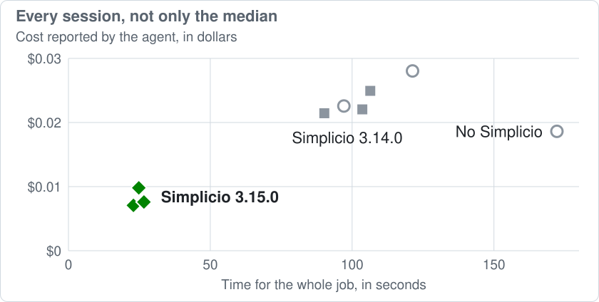

<div align="center">


<h1>Simplicio</h1>

<p><b>UltraFast Mode for all.</b></p>

<p><b>同じエージェント、同じモデル、同じジョブ：121&nbsp;s&nbsp;→&nbsp;25&nbsp;s、$0.0226&nbsp;→&nbsp;$0.0076。</b></p>

<p>Simplicio なし → Simplicio 3.15.0 あり。Claude Code で Claude Haiku 5.5 を使い、一つの小さなコーディングジョブを 3 回実行したときの中央値です。</p>

<p>Simplicio は、お使いのマシン上で動作し、すでに使っているコーディングエージェントにツールを追加します。</p>

<p>
  <a href="https://github.com/simpletibr/simplicio/releases/latest"></a>
  <a href="https://simpleti.com.br/simplicio/docs"></a>
  <a href="https://github.com/simpletibr/simplicio/stargazers"></a>
  
</p>

<p>
  <a href="../README.md">English</a> ·
  <a href="README.pt-BR.md">Português (Brasil)</a> ·
  <a href="README.es-ES.md">Español</a> ·
  <a href="README.fr-FR.md">Français</a> ·
  <a href="README.it-IT.md">Italiano</a> ·
  <a href="README.pl-PL.md">Polski</a> ·
  <a href="README.ru-RU.md">Русский</a> ·
  <a href="README.zh-CN.md">简体中文</a> ·
  日本語 ·
  <a href="README.ko-KR.md">한국어</a> ·
  <a href="README.hi-IN.md">हिन्दी</a> ·
  <a href="README.ar-SA.md">العربية</a>&lrm; ·
  <a href="README.he-IL.md">עברית</a>&lrm; ·
  <a href="README.id-ID.md">Bahasa Indonesia</a> ·
  <a href="README.ms-MY.md">Bahasa Melayu</a>
</p>

<p align="center"><sub>このファイルは <a href="../README.md">英語版 README</a> の翻訳です。内容に違いがある場合は英語版が正です。図表の文字は英語のままです。</sub></p>

</div>

<p align="center">
  <picture>
    <source media="(prefers-color-scheme: dark)" srcset="../assets/benchmark-2026-11-22-dark.svg">
    
  </picture>
</p>

<p align="center">
  <sub>各セットアップ（Simplicio なし、Simplicio 3.14.0、Simplicio 3.15.0）の 3 セッションの中央値。Claude Code 2.1.330 上の Claude Haiku 5.5、2026-11-22。すべてのセットアップで、9 件中 9 件のステップを完了しました。各棒の細い線は、最小のセッションから最大のセッションまでの範囲を示します。<br>
  <a href="../benchmarks/2026-11-22-standard-benchmark.md">方法、データ、制限事項</a></sub>
</p>

<p align="center">
  <sub>併せて読む際の注意：小さなジョブ一つ、セットアップごとに三セッション、モデル一つです。外部検証は、プロンプトで求めた内容より狭い範囲しか確認しません。ピークメモリは高くなりました：375 MB 対 270 MB。Simplicio のビルドは、リリースのコミットからコンパイルし、サインインをオフにした状態で作成しました。</sub>
</p>

<p align="center">Simplicio がこの結果を得る仕組みは公開していません。測定結果は、Simplicio が負けた場合も含めて公開しています。</p>

<p align="center">
  <b>試してみる：</b> <a href="#install">インストール</a> · <a href="#first-run">初回実行</a><br>
  <a href="#what-simplicio-is">概要</a> ·
  <a href="#the-measurement">測定</a> ·
  <a href="#works-with-the-agent-you-already-use">エージェント</a> ·
  <a href="#command-line">コマンド</a> ·
  <a href="#safety-and-privacy">プライバシー</a> ·
  <a href="#questions-people-ask">よくある質問</a> ·
  <a href="#documentation-and-community">ドキュメント</a>
</p>

<a id="what-simplicio-is"></a>

## Simplicio とは

Simplicio は、お使いのコーディングエージェントに超高速モードを与えるローカルプログラムです。エージェントやモデルの種類は問いません。このページの数値は、一つのエージェントと一つのモデルで測ったものです。何を測ったかは、下のセクションに正確に書いています。

- **お使いのエージェントとモデルはそのまま使えます。** Simplicio は、Claude Code、Codex、Cursor、またはそれらの背後にあるモデルを置き換えるものではありません。
- **署名付きのバイナリ一つ**が、お使いのエージェントに自身を登録し、お使いのマシン上でローカルの STDIO MCP サーバーとして動作します。
- **変わるのはセッションです。** かかる時間と、そのコストです。

<p align="center">
  <picture>
    <source media="(prefers-color-scheme: dark)" srcset="../assets/diagram-where-simplicio-runs-dark.svg">
    
  </picture>
</p>

<p align="center">
  <sub>この図は既定の動作です。[完全な一覧](#safety-and-privacy)には、ほかのサービスも載っています。</sub>
</p>

<details>
<summary>MCP と STDIO</summary>

MCP は Model Context Protocol の略で、コーディングエージェントが外部のツールを呼び出す方法です。STDIO は、エージェントがプログラム自体を起動し、標準入力と標準出力を通じてやり取りすることを意味します。

エージェントにツールを与えます。リポジトリのマップ、サイズを制限したコンテキスト、構造化された編集と検証です。[主要なツール](#works-with-the-agent-you-already-use)は、以下に一覧しています。

署名付きのネイティブバイナリを一つインストールします。インストーラーは署名を検証し、お使いのマシンで見つかったエージェントに Simplicio を登録します。

</details>

<a id="the-measurement"></a>

## 測定

一つのジョブを、Simplicio ありとなしで同じ方法で実行しました。ジョブは一つのエージェントセッションの三つのステップで、各結果はセッションの外から検証しています：

1. ユーザー一覧を作る：API と、表、検索、並べ替えのあるページ。
2. 変更する：列を一つ削除し、役割による絞り込みと日付の列を追加する。
3. 登録機能を追加する：入力を検証する `POST` エンドポイントと、フォームのページ。

<p align="center">
  <picture>
    <source media="(prefers-color-scheme: dark)" srcset="../assets/benchmark-2026-11-22-sessions-dark.svg">
    
  </picture>
</p>

| 指標 | Simplicio なし | Simplicio 3.14.0 | Simplicio 3.15.0 |
|---|---|---|---|
| ジョブ時間 | 121 s<br><sub>97–172</sub> | 104 s<br><sub>90–106</sub> | **25 s**<br><sub>23–27</sub> |
| 報告コスト | $0.0226<br><sub>0.0186–0.0280</sub> | $0.0220<br><sub>0.0214–0.0249</sub> | **$0.0076**<br><sub>0.0071–0.0098</sub> |
| モデルリクエスト | 25<br><sub>19–33</sub> | 18<br><sub>18–22</sub> | **10**<br><sub>10–10</sub> |
| ツール呼び出し | 22<br><sub>16–30</sub> | 15<br><sub>15–19</sub> | **7**<br><sub>7–7</sub> |
| 出力トークン | 18,162<br><sub>15,599–23,328</sub> | 19,722<br><sub>18,764–24,997</sub> | **3,211**<br><sub>3,068–3,573</sub> |
| 入力トークン | 34,691<br><sub>30,447–42,543</sub> | 34,141<br><sub>33,121–40,017</sub> | 18,755<br><sub>18,466–33,300</sub> |
| CPU 時間 | 8.5 s<br><sub>8.5–9.2</sub> | 10.0 s<br><sub>8.9–10.0</sub> | **5.3 s**<br><sub>5.3–5.5</sub> |
| ピークメモリ | **270 MB**<br><sub>248–274</sub> | 436 MB<br><sub>432–439</sub> | 375 MB<br><sub>365–379</sub> |
| 完了したステップ | 9 件中 9 件 | 9 件中 9 件 | 9 件中 9 件 |

中央値は 3 セッションの値です。各値の下に、最小から最大までの範囲を示しています。太字は、範囲が重ならない行の最良の値を示します。「9 件中 9 件」は、3 ステップを 3 セッションそれぞれで行い、すべての外部検証に合格したことを示します。

セッションごとのモデルリクエストとツール呼び出し。

<p align="center">
  <picture>
    <source media="(prefers-color-scheme: dark)" srcset="../assets/benchmark-2026-11-22-work-dark.svg">
    
  </picture>
</p>

ステップごとの時間を、同じ尺度で示します。

<p align="center">
  <picture>
    <source media="(prefers-color-scheme: dark)" srcset="../assets/benchmark-2026-11-22-steps-dark.svg">
    
  </picture>
</p>

<details>
<summary>ステップごとの正確な数値</summary>

各セルは、そのステップの中央値の時間と中央値のコストです：

| ステップ | Simplicio なし | Simplicio 3.14.0 | Simplicio 3.15.0 |
|---|---|---|---|
| 1. ビルド | 57.3 s / $0.0111 | 53.7 s / $0.0137 | 5.8 s / $0.0022 |
| 2. 変更 | 17.3 s / $0.0040 | 15.2 s / $0.0032 | 8.9 s / $0.0023 |
| 3. 登録 | 31.4 s / $0.0075 | 27.5 s / $0.0056 | 10.3 s / $0.0026 |

</details>

**読み方。** ジョブ全体は、コストが約三分の一で、4.9 倍速く完了しました。Simplicio なしで最も速いセッション（97.1 s）でさえ、3.15.0 で最も遅いセッション（26.6 s）より 3.7 倍遅い結果でした。[方法、制限事項](../benchmarks/2026-11-22-standard-benchmark.md#limits)

<details>
<summary>各数値の定義</summary>

- 比率は、丸めていない中央値から算出しています。前のリリースと比べると、ジョブ全体は 4.2 倍速くなりました。
- 各中央値は個別に算出しているため、ステップの中央値を合計しても、ジョブ全体の中央値とは一致しません。
- 最悪の場合：Simplicio なしで最も速いセッション（97.1 s）でさえ、Simplicio 3.15.0 で最も遅いセッション（26.6 s）より 3.7 倍遅く、Simplicio なしで最も安いセッション（$0.0186）でさえ、Simplicio ありで最も高いセッション（$0.0098）の 1.9 倍のコストでした。
- ベースラインは、Claude Code 2.1.330 を、標準のツールだけで実行したものです。MCP サーバーも Simplicio の設定もありません。
- 各ステップは、セッションの外から検証しています。API は HTTP で呼び出し、ページはヘッドレス Chrome で読み込みました。ヘッドレス Chrome は、ウィンドウのない Chrome です。
- 外部検証は、検索ボックス、並べ替え、保存後のリダイレクト、ページの見た目、コードの品質を確認していません。
- モデルリクエストは、モデルへの一回の呼び出しです。ツール呼び出しは、エージェントによるツールの一回の使用です。
- 報告コストは、使用したトークン数に、モデルの公開価格を掛けたものです。モデルのトークンだけを数えています。請求書ではありません。
- 入力トークンの範囲は重なっているため、この実行では入力トークンに差があるとは主張しません。
- セッションは一台のマシンで四つずつ同時に実行しました。時間を比べられるのは、このラウンド内だけです。

</details>

<a id="where-simplicio-does-not-win"></a>

### Simplicio が効果を示さない場合

<p align="center">
  <picture>
    <source media="(prefers-color-scheme: dark)" srcset="../assets/benchmark-2026-11-22-memory-dark.svg">
    
  </picture>
</p>

- **メモリ。** ピークメモリは 39% 高く、375 MB 対 270 MB でした。
- **前のリリースは、このジョブで効果を示しませんでした。** Simplicio 3.14.0 のコストは Simplicio なしと同じでした。
- **短い単発の Python スクリプト。** Simplicio 3.10.8 のほうが遅く（19.6 s 対 11.4 s）、その後は再測定していません。
- **小さなページ 1 つ、高性能モデル。** Simplicio 3.15.0 は 14% から 47% 遅くなりました。
- **インストールするものと、測定したものは完全に同じではありません。** ビルドはリリースのコミットからコンパイルし、サインインをオフにした状態で作成しました。
- **サンプルが少ない。** セットアップごとに三セッション、モデル一つ、プロジェクト一つです。

<details>
<summary>制限事項の全文</summary>

- **メモリ。** ピークメモリは、標準のエージェントと比べて 39% 高くなりました：375 MB 対 270 MB。
- **前のリリースは、このジョブで効果を示しませんでした。** Simplicio 3.14.0 のコストは Simplicio なしと同じで、その時間の差は実行ごとのばらつきの範囲内です。効果は 3.15.0 で初めて現れました。
- **短い単発の Python スクリプト。** 以前のラウンドでは、試したすべてのモデルで、Simplicio 3.10.8 は標準のエージェントより遅くなりました。Claude Code 上の Claude Sonnet 5.5 では、Simplicio ありで 19.6 s、$0.0548、なしで 11.4 s、$0.0283 でした。3.15.0 では再測定していません。
- **小さなページ 1 つ、高性能モデル。** Sonnet 5.5 または Opus 5.5 では、Simplicio 3.15.0 は 6 件中 6 件で、時間が 14% から 47%、コストが 14% から 41% 多くかかりました。どのページも、どちらの場合も正しいものでした。Sonnet 5.5、作成、3 回の中央値：Simplicio ありで 24 s、$0.082、なしで 20 s、$0.066 でした。修正は進行中で、まだリリースには入っていません。
- **インストールするものと、測定したものは完全に同じではありません。** ビルドはリリースのコミットからコンパイルし、サインインとバックグラウンドプロセスをオフにした状態で作成しました。署名付きのダウンロード版は測定していません。
- **サンプルが少ない。** セットアップごとに三セッション、モデル一つ、小さな新規プロジェクト一つ、マシン一台、同時に四セッションです。セッションは一つも除外せず、再実行もしていません。比率は、このジョブの測定値であり、お使いのジョブについての値ではありません。私たちは、お使いの作業のどの程度がこのジョブに似ているかを測定していません。

</details>

### 自分で確認する

[レポート](../benchmarks/2026-11-22-standard-benchmark.md)には、三つのプロンプト（ポルトガル語、翻訳付き）、すべての外部検証、すべてのセッションが掲載されています。[データファイル](../benchmarks/2026-11-22-standard-benchmark.json)には、それらが JSON 形式で入っています。テストハーネスは公開していません。

<a id="install"></a>

## インストール

macOS / Linux:

```bash
curl -fsSL https://raw.githubusercontent.com/simpletibr/simplicio/master/install.sh | sh
```

Windows (PowerShell):

```powershell
irm https://raw.githubusercontent.com/simpletibr/simplicio/master/install.ps1 | iex
```

Python (PyPI):

```bash
python3 -m pip install --upgrade simplicio-installer
simplicio install
```

Windows では、`py -m pip install --upgrade simplicio-installer` を使い、続けて `simplicio install` を実行してください。

インストーラーは、署名付きリリースを検証し、見つかったエージェントに Simplicio を自動的に登録します。その後、`simplicio auth login` でサインインしてください。

<details>
<summary>インストールの詳細</summary>

- インストーラーは、お使いのプラットフォーム向けの最新の署名付きリリースをダウンロードし、インストール済みのバイナリを置き換える前に、その SHA-256 と Ed25519 署名を検証します。
- バイナリは `~/.simplicio/bin/` に置かれます（Windows では `%USERPROFILE%\.simplicio\bin\`）。また、見つかったエージェントに Simplicio を自動的に登録します。登録に失敗した場合、インストーラーは成功を報告せずに停止します。
- すでに開いているエージェントは再起動し、設定を読み込み直してください。Python のスクリプトフォルダーが `PATH` にない場合は、先に追加してください。

**サインイン。** ベータ期間中も含め、Google サインインが必要です。`simplicio auth login` を実行し、続けて `simplicio auth status --json` を実行して、`active: true` と報告されたら次に進みます。登録はサインインの前でも行えます。エージェントの設定に、パスワードやトークンを貼り付けないでください。

Simplicio が読み込まれたことを確認するには、エージェントの MCP サーバー一覧で `simplicio` を探してください。Claude Code では、`/mcp` で接続中のサーバーを一覧できます。先にインストーラーを読みたい場合は、[install.sh](../install.sh) を開いてください。

更新するには、いつでもインストーラーをもう一度実行してください。どちらのインストーラーも、実行すると最新リリースを取得します。`install.sh` と `install.ps1` は、このリポジトリのルートにあります。

```bash
# macOS / Linux
sh install.sh --doctor
sh install.sh --uninstall --keep-data
sh install.sh --uninstall --purge       # needs SIMPLICIO_CONFIRM_PURGE=1; preserves ~/.simplicio/.env
```

```powershell
# Windows
pwsh install.ps1 -Doctor
pwsh install.ps1 -Uninstall -KeepData
pwsh install.ps1 -Uninstall -Purge      # needs SIMPLICIO_CONFIRM_PURGE=1; preserves .env
```

- `--doctor` はインストールを確認します。
- `--uninstall --keep-data` は、インストール済みのバイナリを削除し、データは残します。これには、`~/.simplicio/login.json` にある 30 日間の Google サインイン状態も含まれます。
- `--uninstall --purge` は、Simplicio が管理する状態だけを削除します。サインイン状態も含みます。`~/.simplicio/.env` は残します。このファイルには、プロバイダーの認証情報が置かれている場合があるためです。パージには `SIMPLICIO_CONFIRM_PURGE=1` が必要です。
- アンインストールは、エージェントの設定を編集しません。Simplicio の項目は、各エージェント自身の設定で削除するまで残ります。
- プロジェクト自身の `.simplicio` フォルダー内のデータは、`--keep-data` では削除されません。`--purge` を選ぶ前に、対象を確認してください。

詳しくは [INSTALL.md](../INSTALL.md) を参照してください。

</details>

<a id="first-run"></a>

## 初回実行

```bash
simplicio version
cd my-project
simplicio onboard
```

`simplicio version` はインストールを確認します。`simplicio onboard` はプロジェクトを準備します。その後、そのプロジェクトでエージェントを開いてください。

<a id="works-with-the-agent-you-already-use"></a>

## すでにお使いのエージェントで動作

インストーラーは、登録を Simplicio 自身の登録機能に任せます。設定方法を把握しているエージェントに対して、Simplicio の項目を書き込みます。対象には、Claude Code、Codex、Cursor、Visual Studio Code、OpenCode、Gemini CLI、Kiro などが含まれます。

レジストリ [`plugins/simplicio/host-surfaces.json`](../plugins/simplicio/host-surfaces.json) には 43 のエージェント ID があり、互換性マトリックス [`docs/hosts/compatibility-matrix.md`](../docs/hosts/compatibility-matrix.md) では、12 が対応済み、29 が `unverified` とマークされています。`unverified` の連携は、テストされていないものとして扱ってください。

<details>
<summary>43 のエージェントすべて（Simplicio の接続方法別）</summary>

- レジストリには 43 のエージェント ID と、Simplicio が各エージェントに接続する方法が記載されています。接続方法は、Simplicio が書き込む MCP の項目（23）、ネイティブのプラグインまたは拡張（5）、ポータブルなプラグインパッケージ（4）、自分で手順に従うガイド付きセットアップ（9）、その他のコマンドラインツール（2）のいずれかです。
- 互換性マトリックスには、Codex と Gemini CLI の行がありません。レジストリで Simplicio が項目を書き込むと示されていても、`unverified` の連携は、テストされていないものとして扱ってください。
- 23 のエージェントには、[`docs/hosts/`](../docs/hosts/) にガイドがあります。プラグイン経由で接続するエージェントでは、プラグインは別の手順で適用されます。この手順では、あなたの同意を求めます。説明は [INSTALL.md](../INSTALL.md) にあります。

| Simplicio の接続方法 | 件数 | エージェント |
|---|---|---|
| Simplicio が書き込む MCP の項目 | 23 | **xAI Grok Build**, MiMo Code, Amp, OpenClaude, Antigravity, **Pi**, **oh-my-pi**, Goose, Auggie, Autohand Code, Charm, Cline, Command Code, Continue, Droid, Kilocode, Kimi, Mistral Vibe, Rovo Dev, **Visual Studio Code**, **Meta Muse Code**, **OpenMausBot**, **OpenMuse (Python)** |
| ネイティブのプラグインまたは拡張 | 5 | **Claude Code**, Codex, **OpenCode**, Hermes Agent, Gemini CLI |
| ポータブルなプラグインパッケージ | 4 | **Cursor**, GitHub Copilot, **Kiro**, Qwen Code |
| 自分で手順に従うガイド付きセットアップ | 9 | Devin, Codebuff, CopilotKit OpenDots, CopilotKit OpenBot, agentes.chat, OpenAI dots, xAI Grok Bot, Meta Muse app, Cue by Manus |
| その他のコマンドラインツール | 2 | **OrcaDev / Orca ADE**, T3 Code |

太字は、互換性マトリックスで対応済みとマークされたエージェントです。

</details>

エージェントに与えられる主要なツールは次のとおりです：

| ツール | 得られるもの |
|---|---|
| `simplicio_map` | エージェントがリポジトリ内を把握できるようにする、リポジトリの簡潔なマップ |
| `simplicio_context` | タスクに必要なコンテキストを、ファイル全体ではなく、サイズを制限して提供 |
| `simplicio_edit` | 準備された計画に基づく、構造化されたファイル編集 |
| `simplicio_validate` | パイプライン、テスト、納品の検証 |
| `simplicio_run` | Simplicio の管理下で実行するタスク |

[MCP-CONNECT.md](../MCP-CONNECT.md) で、主要なツールを説明しています。

<details>
<summary>手動設定</summary>

Simplicio はローカルの STDIO MCP サーバーです。そのため、ローカルの MCP サーバーを起動できるエージェントなら、Simplicio を接続先に指定できます。登録をやり直すには、`simplicio mcp register` を実行してください。サーバーのコマンドは `simplicio serve --mcp --stdio` です。

エージェントが自動で設定されていない場合は、この項目をエージェントの MCP 設定に追加してください。パスは、インストール済みのバイナリの絶対パスに置き換えてください。

```json
{
  "mcpServers": {
    "simplicio": {
      "command": "/absolute/path/to/.simplicio/bin/simplicio",
      "args": ["serve", "--mcp", "--stdio"]
    }
  }
}
```

Codex は TOML を読みます。エージェントは `command` を直接起動するため、`~` は使わず、シェルの展開にも頼らないでください。Windows のパスでは / を使い、例のユーザー名は置き換えてください。

Windows:

```toml
[mcp_servers.simplicio]
command = "C:/Users/YourName/.simplicio/bin/simplicio.exe"
args = ["serve", "--mcp", "--stdio"]
```

macOS:

```toml
[mcp_servers.simplicio]
command = "/Users/your-name/.simplicio/bin/simplicio"
args = ["serve", "--mcp", "--stdio"]
```

Linux:

```toml
[mcp_servers.simplicio]
command = "/home/your-name/.simplicio/bin/simplicio"
args = ["serve", "--mcp", "--stdio"]
```

各エージェントが設定ファイルを置く場所は、[MCP-CONNECT.md](../MCP-CONNECT.md) を参照してください。

</details>

<a id="command-line"></a>

## コマンドライン

| コマンド | 得られるもの |
|---|---|
| `simplicio map --repo . --for-llm markdown` | モデルが読むための、リポジトリの簡潔な構造マップ |
| `simplicio context --repo .` | タスクに必要な、サイズを制限したコンテキスト |
| `simplicio memory query "query" --json` | インデックス化されたメモリから呼び出した、プロジェクトの既知の情報（JSON 形式） |
| `simplicio edit --plan plan.json --repo .` | 準備された構造化編集の一式を、ファイルに適用する |
| `simplicio run "task" --repo . --agents N` | N 個のエージェントを使い、Simplicio の管理下で実行するタスク |
| `simplicio loop` | 収束するまでラウンドを続ける作業 |

Simplicio のメッセージに出てくる名前は次のとおりです：Mapper は観察し、Fast は投影または取得し、Dev CLI は編集し、Runtime は統制し、Loop は収束します。

<a id="safety-and-privacy"></a>

## 安全性とプライバシー

このセクションは、バージョン 3.15.0 について説明しています。

- **お使いのマシン内で完結します。** マッピング、コンテキスト、編集、検証は、Simplicio のバイナリ内で実行されます。
- **SimpleTI（simpleti.com.br）への送信。** サインインとプランの確認だけで、リポジトリの内容は含みません。
- **GitHub への送信。** 無効にできる、リリースの確認です。
- **アナリティクスなし。** Simplicio は、アナリティクス、クラッシュレポート、利用データをアップロードしません。
- **設定したサービスへの送信。** その機能が送信する内容を受け取ります。その内容には、プロンプトやコードが含まれることがあります。
- **二つの機能は、設定なしで公開サービスに接続します。** Web 検索（DuckDuckGo）と依存関係の監査（osv.dev）です。どちらも、ファイルの内容は送信しません。
- **ダウンロード。** GitHub から行います。一部の補助スクリプトは、PyPI または npm からもツールを取得します。

<details>
<summary>詳細</summary>

- **お使いのマシン内で完結します。** マッピング、コンテキスト、編集、検証は、Simplicio のバイナリ内で実行されます。結果は、同じマシン上のエージェントに渡します。利用記録と節約量の記録は、ローカルファイルです。エージェントがモデルプロバイダーに何を送信するかは、これまでどおりエージェントが決めます。
- **SimpleTI（simpleti.com.br）への送信。** サインインとプランの確認だけで、リポジトリの内容は含みません。ファイル、ファイルパス、プロンプト、編集内容も含みません。
  - 送信するのは、サインイントークン、Simplicio のバージョン、お使いのコンピューターのホスト名です。任意のライセンス確認では、アカウントのメールアドレスも送信します。
  - 返されるのは、アカウントのメールアドレス、名前、プランです。
- **GitHub への送信。** 新しいリリースを確認するバックグラウンドのチェックで、頻度は最大で約 12 時間に一回です。あなたやコードに関する情報は含みません。無効にするには `SIMPLICIO_DISABLE_AUTO_UPDATE=1` を設定してください。更新では、GitHub からバイナリをダウンロードし、古いバイナリを置き換える前に、その SHA-256 と署名を検証します。
- **アナリティクスなし。** Simplicio 3.15.0 と、Simplicio がエージェントに入れるファイルは、この点を確認済みです。どれも、アナリティクス、クラッシュレポート、利用データをアップロードしません。インストールされるフックは、ローカルのプログラムだけを実行します（Simplicio のバイナリと、任意のプラグインの場合はローカルスクリプト）。どのフックも、ネットワークに接続しません。
- **設定したサービスへの送信。** モデルプロバイダー、GitHub、Jira、チャット通知ツール、チームのキャッシュは、その機能が送信する内容を受け取ります。内容にはプロンプトやコードが含まれることがあります。モデルプロバイダーへのリクエストには、クライアントとして Simplicio の名前を記載したヘッダーが付きます。
- **二つの機能は、設定なしで公開サービスに接続します。** どちらもファイルの内容は送信しません。
  - Web 検索は、実行されると、別の検索サービスを設定しない限り、検索クエリを DuckDuckGo に送信します。Simplicio 独自のチャットでは、Web の質問に見えるメッセージが、そのクエリになることがあります。
  - 依存関係のセキュリティ監査は、実行すると、依存関係の名前とバージョンを osv.dev に送信します。
- **ダウンロード。** インストーラーと更新の経路は、GitHub からダウンロードします。任意の補助スクリプトの一部は、実行時に独自のツールを PyPI または npm から取得します。エージェントのプラグインが Simplicio のバイナリを見つけられない場合は、コミットに固定され、SHA-256 で検証された公式インストーラーを GitHub からダウンロードします。

**署名付きリリース。** 各リリースでは、バイナリを SHA-256 チェックサム、Ed25519 署名、SBOM（ビルドに含まれるものの一覧）、ビルドの来歴情報とともに公開します。

インストーラーと更新の経路は、インストール済みのバイナリを置き換える前に、チェックサムと署名を検証します。安定版では、署名がない場合、署名が無効な場合、チェックサムが一致しない場合を、いずれも致命的な失敗として扱います。契約は [docs/UPDATE_SIGNATURE_CONTRACT.md](../docs/UPDATE_SIGNATURE_CONTRACT.md) にあります。

**インストーラーがエージェントに加える変更。**

- Simplicio の項目を、エージェントの MCP 設定に追加し、設定のそれ以外の部分は残します。
- Claude Code では、`mcp__simplicio__*` も許可します。そのため、オートモードで Simplicio のツールが拒否されることはありません。
- インストーラーがフックのインターフェースを検証済みのエージェントでは、Simplicio のフックもそこにインストールします。
- アンインストールしても、これらの項目は元に戻りません。削除方法は「インストール」セクションに記載しています。インストーラーが書き込む内容は [INSTALL.md](../INSTALL.md) に、各エージェントの詳細は [`docs/hosts/`](../docs/hosts/) 内の各ガイドに記載しています。

</details>

## このリポジトリのその他の内容

<details>
<summary>デスクトップアプリ（macOS プレビュー）</summary>

macOS（Apple Silicon）向けのデスクトップアプリのプレビューは、[Simplicio-3.8.47-arm64.dmg](https://github.com/simpletibr/simplicio/releases/download/v3.8.47/Simplicio-3.8.47-arm64.dmg) として公開されています。その SHA-256 は [DESKTOP-SHA256SUMS](../DESKTOP-SHA256SUMS) にあり、Simplicio バイナリのチェックサムとは別になっています。DMG には署名ファイルがなく、Simplicio 3.8.47 のバイナリを同梱しています。

- Windows 版のデスクトップアプリは公開していません。Windows では、上記のコマンドラインからのインストールを使ってください。
- Apple Developer ID による署名と公証（notarization）は行っていません。パッケージは ad-hoc 署名です。これは、Apple の開発者証明書を使わずに署名したという意味です。Gatekeeper による受け入れを主張していないため、開くときに macOS が警告を表示することがあります。
- 署名付きのデスクトップアプリのパッケージが公開されるまでは、上記のコマンドラインからのインストールが、サポートされている公式のインストール方法です。

詳しくは [docs/desktop/RELEASE.md](../docs/desktop/RELEASE.md) を参照してください。

</details>

<details>
<summary>メンテナー向け：生成されたフロー図</summary>

- README.md と MCP-CONNECT.md に記載されたコマンドとツールは、一つのフローとして [docs/flow/simplicio.svg](../docs/flow/simplicio.svg) に描かれています。このフローは、一つのソースファイル `docs/flow/simplicio.flow.json` から生成しています。
- 再生成するには `python3 scripts/generate_flow.py` を、ずれがないか確認するには `python3 scripts/generate_flow.py --check` を実行してください。
- このページおよび MCP-CONNECT.md との整合性を保つ契約は、`python3 -m pytest tests/test_flow_contract.py -q` です。
- Langflow のインポート確認は `scripts/verify_flow_langflow.py` で行います。サーバーが起動していない場合は、安全側に倒れて失敗します（終了コード 2、`status=blocked`）。証跡は `docs/flow/evidence/` と `docs/flow/render/` にあります。要件と再現方法は [docs/flow/README.md](../docs/flow/README.md) に記載しています。

</details>

<a id="questions-people-ask"></a>

## よくある質問

**比較は公平ですか？**<br>
同じエージェント、同じモデル、プロンプト、プロジェクト、外部検証で比べています。ベースラインには Simplicio がありません。[Simplicio が効果を示さない場合](#where-simplicio-does-not-win) を参照してください。

**エージェントやモデルを変更する必要がありますか？**<br>
いいえ。Simplicio は、すでにお使いのエージェントに組み込まれます。

**この数値が必ず得られますか？**<br>
いいえ。これらの数値は、一つのジョブ、一つのモデル、一台のマシンを測ったものです。

**オープンソースですか？**<br>
いいえ。Simplicio はプロプライエタリで、署名付きのバイナリです。このリポジトリには、インストーラー、パッケージ、ドキュメント、データが入っています。

**削除するにはどうすればよいですか？**<br>
`sh install.sh --uninstall --keep-data` を実行してください。Windows では、`pwsh install.ps1 -Uninstall -KeepData` を実行します。アンインストールはエージェントの設定を編集しないため、Simplicio の項目は各エージェント自身の設定で削除してください。

**アカウントは必要ですか？**<br>
はい。ベータ期間中も含め、Google サインインが必要です。`simplicio auth login` を実行してください。

**コードがマシンの外に出ますか？**<br>
マッピング、コンテキスト、編集、検証は、お使いのマシン上で実行されます。SimpleTI と GitHub は、リポジトリの内容を受け取りません。[詳細](#safety-and-privacy)

<a id="documentation-and-community"></a>

## ドキュメントとコミュニティ

- **ウェブサイト：** [simpleti.com.br/simplicio](https://simpleti.com.br/simplicio/)
- **ドキュメント：** [simpleti.com.br/simplicio/docs](https://simpleti.com.br/simplicio/docs)
- **Discord：** [コミュニティに参加](https://discord.gg/wM6tr7xVb)
- **Issue：** [GitHub の issue トラッカー](https://github.com/simpletibr/simplicio/issues)
- **関連：** Simplicio Video（hypit）。複製するには：`git clone https://github.com/hypit-ai/hypit.git simplicio-video`

<p align="center">
  <sub>© 2026 SimpleTI. Simplicio は登録済みのプロプライエタリソフトウェアです。すべての権利を留保します。</sub>
</p>
