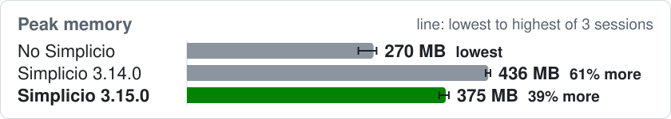

<div align="center">


<h1>Simplicio</h1>

<p><b>UltraFast Mode for all.</b></p>

<p><b>같은 에이전트, 같은 모델, 같은 작업: 121&nbsp;s&nbsp;→&nbsp;25&nbsp;s, 비용은 $0.0226&nbsp;→&nbsp;$0.0076.</b></p>

<p>Simplicio 없이 → Simplicio 3.15.0 사용. Claude Code에서 Claude Haiku 5.5로 실행한 작은 코딩 작업 하나를 3회 실행한 중앙값입니다.</p>

<p>Simplicio는 사용자의 컴퓨터에서 실행되며, 이미 사용 중인 코딩 에이전트에 도구를 추가합니다.</p>

<p>
  <a href="https://github.com/simpletibr/simplicio/releases/latest"></a>
  <a href="https://simpleti.com.br/simplicio/docs"></a>
  <a href="https://github.com/simpletibr/simplicio/stargazers"></a>
  
</p>

<p>
  <a href="../README.md">English</a> ·
  <a href="README.pt-BR.md">Português (Brasil)</a> ·
  <a href="README.es-ES.md">Español</a> ·
  <a href="README.fr-FR.md">Français</a> ·
  <a href="README.it-IT.md">Italiano</a> ·
  <a href="README.pl-PL.md">Polski</a> ·
  <a href="README.ru-RU.md">Русский</a> ·
  <a href="README.zh-CN.md">简体中文</a> ·
  <a href="README.ja-JP.md">日本語</a> ·
  한국어 ·
  <a href="README.hi-IN.md">हिन्दी</a> ·
  <a href="README.ar-SA.md">العربية</a>&lrm; ·
  <a href="README.he-IL.md">עברית</a>&lrm; ·
  <a href="README.id-ID.md">Bahasa Indonesia</a> ·
  <a href="README.ms-MY.md">Bahasa Melayu</a>
</p>

<p align="center"><sub>이 파일은 <a href="../README.md">영문 README</a>의 번역입니다. 두 내용이 다르면 영문 페이지가 기준입니다. 그림과 수치는 영문으로 되어 있습니다.</sub></p>

</div>

<p align="center">
  <picture>
    <source media="(prefers-color-scheme: dark)" srcset="../assets/benchmark-2026-11-22-dark.svg">
    
  </picture>
</p>

<p align="center">
  <sub>각 설정은 세션 세 개의 중앙값입니다(Simplicio 없음, Simplicio 3.14.0, Simplicio 3.15.0). Claude Code 2.1.330의 Claude Haiku 5.5, 2026-11-22. 모든 설정이 9개 중 9개 단계를 완료했습니다. 각 막대의 가는 선은 가장 낮은 세션부터 가장 높은 세션까지를 나타냅니다.<br>
  <a href="../benchmarks/2026-11-22-standard-benchmark.md">방법, 데이터, 한계</a></sub>
</p>

<p align="center">
  <sub>이 수치를 읽을 때 유의할 점: 작은 작업 하나, 설정마다 세션 세 개, 모델 하나입니다. 외부 검사는 프롬프트가 요구하는 범위보다 좁습니다. 최대 메모리는 더 높았습니다: 270 MB 대비 375 MB. Simplicio 빌드는 릴리스 커밋에서 컴파일되었으며, 로그인 기능을 끈 상태였습니다.</sub>
</p>

<p align="center">Simplicio가 이 결과를 얻는 방식은 공개하지 않습니다. 측정 결과는 공개합니다. Simplicio가 진 경우도 포함합니다.</p>

<p align="center">
  <b>직접 해 보기:</b> <a href="#install">설치</a> · <a href="#first-run">첫 실행</a><br>
  <a href="#what-simplicio-is">개요</a> ·
  <a href="#the-measurement">측정</a> ·
  <a href="#works-with-the-agent-you-already-use">에이전트</a> ·
  <a href="#command-line">명령</a> ·
  <a href="#safety-and-privacy">개인정보</a> ·
  <a href="#questions-people-ask">질문</a> ·
  <a href="#documentation-and-community">문서</a>
</p>

<a id="what-simplicio-is"></a>

## Simplicio란 무엇인가

Simplicio는 이미 사용 중인 코딩 에이전트에 초고속 모드를 제공하는 로컬 프로그램이며, 어떤 에이전트와 어떤 모델이든 상관없습니다. 이 페이지의 수치는 하나의 에이전트와 하나의 모델에서 나온 것입니다. 무엇을 측정했는지는 아래 절에 정확히 적혀 있습니다.

- **에이전트와 모델은 그대로 사용합니다.** Simplicio는 Claude Code, Codex, Cursor 또는 그 뒤에서 동작하는 모델을 대체하지 않습니다.
- **서명된 네이티브 바이너리 하나를 설치합니다.** 설치 프로그램이 서명을 검증한 뒤, 컴퓨터에서 찾은 에이전트에 Simplicio를 등록합니다.
- **컴퓨터에서 실행됩니다.** 에이전트가 Simplicio를 로컬 STDIO MCP 서버로 시작합니다. MCP는 Model Context Protocol이며, 코딩 에이전트가 외부 도구를 호출하는 표준 방식입니다. STDIO는 에이전트가 프로그램을 직접 실행하고, 표준 입력과 표준 출력을 통해 프로그램과 통신한다는 뜻입니다.
- **에이전트에 도구를 제공합니다.** 저장소 맵, 범위가 제한된 컨텍스트, 구조화된 편집과 검사가 있습니다. [핵심 도구](#works-with-the-agent-you-already-use)는 아래에 나열되어 있습니다.
- **달라지는 것은 세션입니다.** 걸리는 시간과 비용이 바뀝니다. 다음 절에서 얼마나 달라지는지, 그리고 어디서는 도움이 되지 않는지 보여 줍니다.

<p align="center">
  <picture>
    <source media="(prefers-color-scheme: dark)" srcset="../assets/diagram-where-simplicio-runs-dark.svg">
    
  </picture>
</p>

<p align="center">
  <sub>이 그림은 기본 상태에서 일어나는 일을 보여 줍니다. 다른 서비스에 닿는 기능까지 포함한 전체 목록은 안전과 개인정보 절의 <a href="#safety-and-privacy">Simplicio가 무엇을, 누구에게 보내는지</a>에 있습니다.</sub>
</p>

<a id="the-measurement"></a>

## 측정

작업 하나를 Simplicio를 쓰는 경우와 쓰지 않는 경우에 같은 방식으로 실행했습니다. 작업은 같은 대화 안의 세 단계로 이루어진 에이전트 세션 하나입니다:

1. 사용자 목록을 만듭니다: API와, 표·검색·정렬 기능이 있는 페이지.
2. 변경합니다: 열 하나를 빼고, 역할별 필터와 날짜 열을 추가합니다.
3. 간단한 등록 기능을 추가합니다: 입력값을 검사하는 `POST` 엔드포인트와 폼 페이지.

모든 단계 뒤에 결과를 세션 외부에서 검사합니다. API는 HTTP로 호출하고, 페이지는 창 없이 실행되는 Chrome(headless Chrome)에서 불러옵니다. 모든 설정은 같은 에이전트와 같은 모델을 사용했습니다. 즉 Claude Code 2.1.330과 Claude Haiku 5.5입니다. 기준선은 자체 도구만 쓰는 Claude Code 2.1.330이며, MCP 서버와 Simplicio 구성이 없습니다. 외부 검사는 검색 상자, 정렬, 저장 후 리디렉션, 페이지의 모양, 코드 품질을 테스트하지 않습니다.

중앙값만이 아니라 모든 세션이 이 차트에 있습니다.

<p align="center">
  <picture>
    <source media="(prefers-color-scheme: dark)" srcset="../assets/benchmark-2026-11-22-sessions-dark.svg">
    
  </picture>
</p>

설정마다 세션 세 개의 중앙값입니다. 각 값 아래의 작은 선은 가장 낮은 세션과 가장 높은 세션을 나타냅니다.

| 측정 항목 | Simplicio 없음 | Simplicio 3.14.0 | Simplicio 3.15.0 |
|---|---|---|---|
| 작업 시간 | 121 s<br><sub>97–172</sub> | 104 s<br><sub>90–106</sub> | **25 s**<br><sub>23–27</sub> |
| 보고된 비용 | $0.0226<br><sub>0.0186–0.0280</sub> | $0.0220<br><sub>0.0214–0.0249</sub> | **$0.0076**<br><sub>0.0071–0.0098</sub> |
| 모델 요청 | 25<br><sub>19–33</sub> | 18<br><sub>18–22</sub> | **10**<br><sub>10–10</sub> |
| 도구 호출 | 22<br><sub>16–30</sub> | 15<br><sub>15–19</sub> | **7**<br><sub>7–7</sub> |
| 출력 토큰 | 18,162<br><sub>15,599–23,328</sub> | 19,722<br><sub>18,764–24,997</sub> | **3,211**<br><sub>3,068–3,573</sub> |
| 입력 토큰 | 34,691<br><sub>30,447–42,543</sub> | 34,141<br><sub>33,121–40,017</sub> | 18,755<br><sub>18,466–33,300</sub> |
| CPU 시간 | 8.5 s<br><sub>8.5–9.2</sub> | 10.0 s<br><sub>8.9–10.0</sub> | **5.3 s**<br><sub>5.3–5.5</sub> |
| 최대 메모리 | **270 MB**<br><sub>248–274</sub> | 436 MB<br><sub>432–439</sub> | 375 MB<br><sub>365–379</sub> |
| 완료한 단계 | 9개 중 9개 | 9개 중 9개 | 9개 중 9개 |

굵은 글씨는 행에서 가장 좋은 값을 나타내며, 그 범위가 다른 값과 겹치지 않을 때만 표시합니다. 입력 토큰의 범위는 서로 겹치므로, 이번 실행은 입력 토큰에서 차이가 있다고 주장하지 않습니다. "9개 중 9개"는 세 세션 각각에서 단계 세 개를 모두 완료했다는 뜻이며, 모든 단계가 모든 외부 검사를 통과했습니다. 작업 시간은 작업 전체의 시간입니다. 모델 요청은 모델을 한 번 호출하는 것이고, 도구 호출은 에이전트가 도구를 한 번 사용하는 것입니다. 보고된 비용은 에이전트가 보고한 값으로, 사용한 토큰에 모델의 공개 가격을 곱한 것입니다. 모델 토큰만 계산하며, 청구서가 아닙니다.

세션에서 바뀐 점을 개수로 보면, 모델 요청이 줄었고 에이전트의 도구 호출도 줄었습니다.

<p align="center">
  <picture>
    <source media="(prefers-color-scheme: dark)" srcset="../assets/benchmark-2026-11-22-work-dark.svg">
    
  </picture>
</p>

단계별 시간을 하나의 공통 눈금에 맞춰 보여 줍니다.

<p align="center">
  <picture>
    <source media="(prefers-color-scheme: dark)" srcset="../assets/benchmark-2026-11-22-steps-dark.svg">
    
  </picture>
</p>

각 중앙값은 따로 계산했으므로, 단계별 값을 더해도 작업 전체의 중앙값과 같아지지 않습니다.

<details>
<summary>단계별 정확한 수치</summary>

각 칸은 해당 단계의 중앙 시간과 중앙 비용입니다:

| 단계 | Simplicio 없음 | Simplicio 3.14.0 | Simplicio 3.15.0 |
|---|---|---|---|
| 1. 빌드 | 57.3 s / $0.0111 | 53.7 s / $0.0137 | 5.8 s / $0.0022 |
| 2. 변경 | 17.3 s / $0.0040 | 15.2 s / $0.0032 | 8.9 s / $0.0023 |
| 3. 등록 | 31.4 s / $0.0075 | 27.5 s / $0.0056 | 10.3 s / $0.0026 |

</details>

**해석 방법.** 비율은 반올림하지 않은 중앙값에서 계산했습니다. Simplicio 없이 같은 에이전트를 쓴 경우와 비교하면 작업 전체가 4.9배 빨랐고, 비용은 약 3분의 1이었습니다. 이전 릴리스와 비교하면 4.2배 빨랐습니다. 세션에서 모델은 25회 대신 10회 요청했고, 출력 토큰은 18,162개 대신 3,211개를 썼으며, 작업은 같은 외부 검사를 통과했습니다. 최악의 경우를 보면, Simplicio 없이 실행한 가장 빠른 세션(97.1 s)도 Simplicio 3.15.0의 가장 느린 세션(26.6 s)보다 3.7배 느렸습니다. Simplicio 없이 실행한 가장 저렴한 세션($0.0186)도 Simplicio를 쓴 가장 비싼 세션($0.0098)보다 1.9배 비쌌습니다. 기준선은 자체 도구만 쓰는 Claude Code 2.1.330이며, MCP 서버와 Simplicio 구성이 없습니다. 비용은 모델 토큰만 계산합니다. 세션은 컴퓨터 한 대에서 네 개씩 동시에 실행되었으므로, 시간은 이번 회차 안에서만 비교하십시오.

<a id="where-simplicio-does-not-win"></a>

### Simplicio가 이기지 못하는 경우

<p align="center">
  <picture>
    <source media="(prefers-color-scheme: dark)" srcset="../assets/benchmark-2026-11-22-memory-dark.svg">
    
  </picture>
</p>

- **메모리.** 최대 메모리는 기본 에이전트보다 39% 높았습니다: 270 MB 대비 375 MB.
- **이전 릴리스는 이 작업에서 이득을 보이지 않았습니다.** Simplicio 3.14.0의 비용은 Simplicio 없음과 같았고, 시간 차이는 실행 간 변동 범위 안에 있습니다. 이 페이지의 이득은 3.15.0에서 나타났습니다.
- **짧은 일회성 Python 스크립트.** 이전 회차에서 Simplicio 3.10.8은 시도한 모든 모델에서 기본 에이전트보다 느렸습니다. Claude Code의 Claude Sonnet 5.5에서는 19.6 s와 $0.0548이 걸렸고, Simplicio 없이는 11.4 s와 $0.0283이 걸렸습니다. 이 작업은 3.15.0으로 다시 측정하지 않았습니다.
- **설치하는 것은 측정한 것과 정확히 같지 않습니다.** 빌드는 릴리스 커밋에서 컴파일되었으며, 로그인 기능과 백그라운드 프로세스를 끈 상태였습니다. 서명된 다운로드 파일은 측정하지 않았습니다.
- **표본이 작습니다.** 설정마다 세션 세 개, 모델 하나, 작은 새 프로젝트 하나, 컴퓨터 한 대에서 세션 네 개를 동시에 실행했습니다. 비율은 이 작업을 측정한 값으로 읽으십시오. 여러분의 작업에서 같은 결과를 약속하는 값이 아닙니다. 이 세 설정의 세션은 하나도 제외하거나 다시 실행하지 않았습니다. 여러분의 작업 중 얼마나 많은 부분이 이 작업과 비슷한지는 측정하지 않았습니다.

### 직접 확인하기

[보고서](../benchmarks/2026-11-22-standard-benchmark.md)에는 프롬프트 세 개(포르투갈어 원문과 번역본), 모든 외부 검사에 대한 설명, 세션별 수치가 게시되어 있습니다. [데이터 파일](../benchmarks/2026-11-22-standard-benchmark.json)에는 같은 내용이 JSON으로 들어 있습니다. 테스트 하네스는 공개하지 않습니다. 같은 프롬프트 세 개를 여러분의 에이전트에서, 작은 프로젝트 하나를 대상으로 Simplicio를 켠 상태와 끈 상태로 실행해 보고, 여러분의 시간과 청구 금액을 비교해 보십시오.

<a id="install"></a>

## 설치

서명된 네이티브 바이너리를 설치하십시오. 방법 하나를 고르십시오.

macOS / Linux:

```bash
curl -fsSL https://raw.githubusercontent.com/simpletibr/simplicio/master/install.sh | sh
```

Windows (PowerShell):

```powershell
irm https://raw.githubusercontent.com/simpletibr/simplicio/master/install.ps1 | iex
```

Python (PyPI):

```bash
python3 -m pip install --upgrade simplicio-installer
simplicio install
```

Windows에서는 `py -m pip install --upgrade simplicio-installer`를 실행한 다음 `simplicio install`을 실행하십시오. Python 스크립트 디렉터리가 `PATH`에 없으면 먼저 추가하십시오.

설치 프로그램은 사용자 플랫폼에 맞는 최신 서명 릴리스를 내려받아 SHA-256과 Ed25519 서명을 확인합니다. 그 뒤에만 설치된 바이너리를 교체합니다. 바이너리는 `~/.simplicio/bin/`에 두며(Windows에서는 `%USERPROFILE%\.simplicio\bin\`), 찾은 에이전트에 Simplicio를 자동으로 등록합니다. 등록에 실패하면 성공으로 보고하지 않고 설치 프로그램이 중단됩니다. 이미 열려 있는 에이전트는 다시 시작해서 구성을 다시 읽도록 하십시오.

**로그인.** 베타 기간에도 Google 로그인이 필요합니다. `simplicio auth login`을 실행한 다음 `simplicio auth status --json`을 실행하고, 상태에 `active: true`가 표시되면 진행하십시오. 등록에는 로그인이 필요하지 않으므로, 로그인하기 전에도 에이전트는 이미 구성되어 있습니다. 에이전트의 구성에 비밀번호나 토큰을 넣지 마십시오.

<details>
<summary>확인, 업데이트, 제거</summary>

업데이트하려면 설치 프로그램을 다시 실행하십시오. 두 설치 프로그램 중 어느 것이든 언제든 다시 실행할 수 있으며, 항상 최신 릴리스를 찾습니다. `install.sh`와 `install.ps1`은 이 저장소의 루트에 있습니다.

```bash
# macOS / Linux
sh install.sh --doctor
sh install.sh --uninstall --keep-data
sh install.sh --uninstall --purge       # needs SIMPLICIO_CONFIRM_PURGE=1; preserves ~/.simplicio/.env
```

```powershell
# Windows
pwsh install.ps1 -Doctor
pwsh install.ps1 -Uninstall -KeepData
pwsh install.ps1 -Uninstall -Purge      # needs SIMPLICIO_CONFIRM_PURGE=1; preserves .env
```

- `--doctor`는 설치 상태를 확인합니다.
- `--uninstall --keep-data`는 설치된 바이너리를 제거하고 데이터는 유지합니다. 여기에는 `~/.simplicio/login.json`에 있는 30일 Google 로그인 상태도 포함됩니다.
- `--uninstall --purge`는 Simplicio가 관리하는 상태만 제거하며, 로그인 상태도 포함됩니다. 제공자 자격 증명이 있을 수 있는 `~/.simplicio/.env`는 남겨 둡니다. purge에는 `SIMPLICIO_CONFIRM_PURGE=1`이 필요합니다.
- 제거해도 에이전트의 구성은 수정되지 않습니다. Simplicio 항목은 각 에이전트 자체의 설정에서 직접 제거하기 전까지 남아 있습니다.
- 프로젝트 자체의 `.simplicio` 폴더 안의 데이터는 `--keep-data`로도 제거되지 않습니다. `--purge`를 고르기 전에 대상을 먼저 확인하십시오.

자세한 내용은 [INSTALL.md](../INSTALL.md)를 보십시오.

</details>

<a id="first-run"></a>

## 첫 실행

```bash
simplicio version
cd my-project
simplicio onboard
```

`simplicio version`은 설치된 바이너리를 확인합니다. `simplicio onboard`는 처음 한 번 프로젝트를 준비합니다. 그다음 해당 프로젝트에서 에이전트를 열고 평소처럼 작업하십시오. Simplicio가 로드되었는지 확인하려면 에이전트의 MCP 서버 목록에서 `simplicio`를 찾으십시오. Claude Code에서는 `/mcp`로 연결된 서버 목록을 볼 수 있습니다. 설치 프로그램을 먼저 읽어 보고 싶으신가요? 해당 파일은 [install.sh](../install.sh)입니다.

<a id="works-with-the-agent-you-already-use"></a>

## 이미 쓰고 있는 에이전트와 함께 작동

Simplicio는 로컬 STDIO MCP 서버이므로, 로컬 MCP 서버를 시작할 수 있는 에이전트라면 이 서버를 가리키도록 설정할 수 있습니다.

설치 프로그램은 등록 작업을 Simplicio 자체 등록기에 맡깁니다. 컴퓨터에서 에이전트를 찾고, 구성 방법을 아는 에이전트에 Simplicio 항목을 씁니다. 여기에는 Claude Code, Codex, Cursor, Visual Studio Code, OpenCode, Gemini CLI, Kiro가 포함됩니다. 이 저장소의 파일 두 개에 각 연동이 어디까지 되는지 나와 있습니다:

- 레지스트리 [`plugins/simplicio/host-surfaces.json`](../plugins/simplicio/host-surfaces.json)에는 에이전트 ID 43개가 있으며, 각 에이전트에 Simplicio가 어떻게 연결되는지 적혀 있습니다. Simplicio가 쓰는 MCP 항목(23), 네이티브 플러그인 또는 확장(5), 이식 가능한 플러그인 패키지(4), 직접 따라 해야 하는 안내 설정(9), 다른 명령줄 도구(2)입니다.
- 호환성 매트릭스 [`docs/hosts/compatibility-matrix.md`](../docs/hosts/compatibility-matrix.md)에는 검증된 내용이 있습니다. 43개 중 12개 에이전트는 지원됨으로, 29개는 `unverified`로 표시되어 있습니다. Codex와 Gemini CLI에 대한 행은 없습니다. 레지스트리에는 Simplicio가 항목을 쓴다고 되어 있지만 매트릭스에 `unverified`로 표시된 경우, 해당 연동은 테스트되지 않은 것으로 보십시오.

23개 에이전트에는 [`docs/hosts/`](../docs/hosts/)에 안내 문서가 있습니다. 플러그인으로 연결되는 에이전트의 경우 플러그인은 사용자 동의를 묻는 별도 단계에서 적용되며, 이 과정은 [INSTALL.md](../INSTALL.md)에 설명되어 있습니다.

<details>
<summary>43개 에이전트 전체, Simplicio가 연결되는 방식별</summary>

| Simplicio가 연결되는 방식 | 개수 | 에이전트 |
|---|---|---|
| Simplicio가 쓰는 MCP 항목 | 23 | **xAI Grok Build**, MiMo Code, Amp, OpenClaude, Antigravity, **Pi**, **oh-my-pi**, Goose, Auggie, Autohand Code, Charm, Cline, Command Code, Continue, Droid, Kilocode, Kimi, Mistral Vibe, Rovo Dev, **Visual Studio Code**, **Meta Muse Code**, **OpenMausBot**, **OpenMuse (Python)** |
| 네이티브 플러그인 또는 확장 | 5 | **Claude Code**, Codex, **OpenCode**, Hermes Agent, Gemini CLI |
| 이식 가능한 플러그인 패키지 | 4 | **Cursor**, GitHub Copilot, **Kiro**, Qwen Code |
| 직접 따라 하는 안내 설정 | 9 | Devin, Codebuff, CopilotKit OpenDots, CopilotKit OpenBot, agentes.chat, OpenAI dots, xAI Grok Bot, Meta Muse app, Cue by Manus |
| 다른 명령줄 도구 | 2 | **OrcaDev / Orca ADE**, T3 Code |

굵은 글씨: 호환성 매트릭스에서 지원됨으로 표시한 에이전트입니다.

</details>

등록을 다시 하려면 `simplicio mcp register`를 실행하십시오. 서버 명령은 `simplicio serve --mcp --stdio`입니다. 에이전트가 받는 핵심 도구는 다음과 같습니다:

| 도구 | 제공하는 기능 |
|---|---|
| `simplicio_map` | 저장소의 간결한 맵으로, 에이전트가 길을 찾을 수 있게 합니다 |
| `simplicio_context` | 파일 전체 대신, 작업에 필요한 범위 제한 컨텍스트 |
| `simplicio_edit` | 준비된 계획에 따른 구조화된 파일 편집 |
| `simplicio_validate` | 파이프라인, 테스트, 전달 검사 |
| `simplicio_run` | Simplicio의 제어 아래 실행되는 작업 |

실제 목록은 서버가 시작할 때 보고하는 목록입니다. [MCP-CONNECT.md](../MCP-CONNECT.md)에 핵심 도구가 설명되어 있습니다.

<details>
<summary>수동 구성</summary>

에이전트가 자동으로 구성되지 않았다면, 이 항목을 에이전트의 MCP 구성에 추가하십시오. 경로는 설치된 바이너리의 절대 경로로 바꾸십시오.

```json
{
  "mcpServers": {
    "simplicio": {
      "command": "/absolute/path/to/.simplicio/bin/simplicio",
      "args": ["serve", "--mcp", "--stdio"]
    }
  }
}
```

Codex는 TOML을 읽습니다. 에이전트는 `command`를 직접 실행하므로 `~`를 쓰지 마십시오. 셸 확장에도 의존하지 마십시오. Windows 경로에는 슬래시(/)를 사용하고, 예시 사용자 이름은 실제 이름으로 바꾸십시오.

Windows:

```toml
[mcp_servers.simplicio]
command = "C:/Users/YourName/.simplicio/bin/simplicio.exe"
args = ["serve", "--mcp", "--stdio"]
```

macOS:

```toml
[mcp_servers.simplicio]
command = "/Users/your-name/.simplicio/bin/simplicio"
args = ["serve", "--mcp", "--stdio"]
```

Linux:

```toml
[mcp_servers.simplicio]
command = "/home/your-name/.simplicio/bin/simplicio"
args = ["serve", "--mcp", "--stdio"]
```

각 에이전트가 설정 파일을 보관하는 위치는 [MCP-CONNECT.md](../MCP-CONNECT.md)에 있습니다.

</details>

<a id="command-line"></a>

## 명령줄

| 명령 | 얻는 결과 |
|---|---|
| `simplicio map --repo . --for-llm markdown` | 모델이 읽도록 작성된, 저장소의 간결한 구조 맵 |
| `simplicio context --repo .` | 작업에 필요한 범위 제한 컨텍스트 |
| `simplicio memory query "query" --json` | 인덱싱된 메모리에서 불러온, 프로젝트가 이미 알고 있는 내용(JSON) |
| `simplicio edit --plan plan.json --repo .` | 준비된 구조화 편집 묶음을 파일에 적용 |
| `simplicio run "task" --repo . --agents N` | Simplicio의 제어 아래, 에이전트 N개로 실행하는 작업 |
| `simplicio loop` | 수렴할 때까지 반복하며 진행되는 작업 |

Simplicio 메시지에서 보게 될 이름: Mapper는 관찰하고, Fast는 투영하거나 검색하며, Dev CLI는 편집하고, Runtime은 관리하고, Loop는 수렴합니다.

<a id="safety-and-privacy"></a>

## 안전과 개인정보

이 절은 버전 3.15.0을 설명합니다.

**Simplicio가 무엇을, 누구에게 보내는지**

- **컴퓨터 안에 머뭅니다.** 맵 만들기, 컨텍스트, 편집, 검사는 Simplicio 바이너리 안에서 실행됩니다. 결과는 같은 컴퓨터의 에이전트에 전달됩니다. 에이전트가 자체 모델 제공자에게 보내는 내용은 이전과 같이 에이전트가 결정합니다.
- **SimpleTI(simpleti.com.br)로.** 로그인과 요금제 확인에만 사용합니다. 여기에는 로그인 토큰, Simplicio 버전, 컴퓨터의 호스트 이름이 포함됩니다. 선택 사항인 라이선스 조회에는 계정 이메일도 포함됩니다. 응답으로 계정 이메일, 이름, 요금제를 돌려받습니다. 저장소 내용은 없습니다. 파일, 파일 경로, 프롬프트, 편집 내용은 보내지 않습니다.
- **GitHub로.** 새 릴리스를 확인하는 백그라운드 검사로, 최대 약 12시간에 한 번 실행됩니다. 사용자나 코드에 관한 정보는 전혀 포함되지 않습니다. 끄려면 `SIMPLICIO_DISABLE_AUTO_UPDATE=1`을 설정하십시오. 업데이트할 때 새 바이너리는 GitHub에서 내려받으며, 기존 바이너리를 교체하기 전에 SHA-256과 서명을 확인합니다.
- **분석 데이터 없음.** Simplicio 3.15.0과 Simplicio가 에이전트에 설치하는 파일들은 이 점을 확인했습니다. 어느 것도 분석 데이터, 충돌 보고서, 사용량 데이터를 업로드하지 않습니다. 사용량과 절감 기록은 로컬 파일입니다. 설치되는 훅은 로컬 프로그램만 실행합니다(Simplicio 바이너리와, 선택 플러그인의 경우 로컬 스크립트). 그중 어느 것도 네트워크에 접속하지 않습니다.
- **사용자가 설정한 서비스로.** 모델 제공자, GitHub, Jira, 채팅 알림 도구, 팀 캐시는 해당 기능이 보내는 내용을 받습니다. 여기에는 프롬프트와 코드가 포함될 수 있습니다. 모델 제공자에 보내는 요청에는 클라이언트로 Simplicio를 밝히는 헤더가 포함됩니다.
- **설정하지 않아도 공개 서비스로 전송되는 기능이 두 가지 있습니다.** 웹 검색은 실행될 때, 다른 검색 서비스를 설정하지 않았다면 검색어를 DuckDuckGo로 보냅니다. Simplicio 자체 채팅에서는 웹 질문처럼 보이는 메시지가 그 검색어가 될 수 있습니다. 의존성 보안 감사는 실행하면 의존성의 이름과 버전을 osv.dev로 보냅니다. 두 기능 모두 파일 내용은 보내지 않습니다.
- **다운로드.** 설치 프로그램과 업데이트 경로는 GitHub에서 내려받습니다. 일부 선택 도우미 스크립트는 실행할 때 자체 도구를 PyPI 또는 npm에서 가져옵니다. 에이전트 플러그인이 시작되었는데 Simplicio 바이너리가 없으면, 커밋에 고정된 공식 설치 프로그램을 GitHub에서 내려받고 SHA-256으로 검사합니다.

**서명된 릴리스.** 각 릴리스는 바이너리를 SHA-256 체크섬, Ed25519 서명, SBOM(빌드에 포함된 항목 목록), 빌드 출처 정보와 함께 게시합니다. 설치 프로그램과 업데이트 경로는 설치된 바이너리를 교체하기 전에 체크섬과 서명을 확인합니다. 안정 릴리스의 경우 계약에 따라 서명이 없거나 잘못되었거나 체크섬이 맞지 않으면 바로 실패로 처리합니다. 계약 내용은 [docs/UPDATE_SIGNATURE_CONTRACT.md](../docs/UPDATE_SIGNATURE_CONTRACT.md)에 있습니다.

**설치 프로그램이 에이전트에서 바꾸는 것.** 에이전트의 MCP 구성에 Simplicio 항목을 추가하고, 나머지 구성은 그대로 둡니다. Claude Code에서는 `mcp__simplicio__*`도 허용하므로, 자동 모드에서 Simplicio 도구가 거부되지 않습니다. 설치 프로그램이 훅 인터페이스를 검증한 에이전트에서는 Simplicio 훅도 함께 설치합니다. 설치 프로그램이 무엇을 쓰는지는 [INSTALL.md](../INSTALL.md)에 있으며, 에이전트별 세부 내용은 [`docs/hosts/`](../docs/hosts/)의 각 안내 문서에 있습니다. 제거해도 이 항목들은 되돌려지지 않습니다. 제거 방법은 설치 절에 나와 있습니다.

## 이 저장소의 다른 내용

<details>
<summary>데스크톱 앱(macOS 미리보기)</summary>

macOS(Apple Silicon)용 데스크톱 미리보기는 [Simplicio-3.8.47-arm64.dmg](https://github.com/simpletibr/simplicio/releases/download/v3.8.47/Simplicio-3.8.47-arm64.dmg)로 게시되어 있습니다. 해당 SHA-256은 [DESKTOP-SHA256SUMS](../DESKTOP-SHA256SUMS)에 있으며, Simplicio 바이너리의 체크섬과는 별도입니다. DMG에는 서명 파일이 없고, Simplicio 3.8.47 바이너리가 포함되어 있습니다.

- Windows용 데스크톱은 게시되지 않았습니다. Windows에서는 위의 명령줄 설치를 사용하십시오.
- Apple Developer ID 서명과 공증(notarization)은 하지 않았습니다. 패키지는 애드혹(ad-hoc) 서명, 즉 Apple 개발자 인증서 없이 서명되어 있으며, Gatekeeper 승인을 주장하지 않습니다. 따라서 열 때 macOS가 경고를 표시할 수 있습니다.
- 서명된 데스크톱 패키지가 게시되기 전까지는 위의 명령줄 설치가 지원되는 공식 설치 경로입니다.

자세한 내용: [docs/desktop/RELEASE.md](../docs/desktop/RELEASE.md)

</details>

<details>
<summary>관리자용: 생성된 흐름도</summary>

README.md와 MCP-CONNECT.md에 문서화된 명령과 도구는 하나의 흐름도 [docs/flow/simplicio.svg](../docs/flow/simplicio.svg)로 그려집니다. 이 그림은 하나의 원본 파일 `docs/flow/simplicio.flow.json`에서 생성됩니다. `python3 scripts/generate_flow.py`로 다시 생성하고, `python3 scripts/generate_flow.py --check`로 어긋남이 없는지 확인합니다. 이 페이지 및 MCP-CONNECT.md와 맞춰 두는 계약은 `python3 -m pytest tests/test_flow_contract.py -q`입니다. Langflow 가져오기 검사는 `scripts/verify_flow_langflow.py`이며, fail closed로 동작합니다. 서버가 실행 중이 아니면 종료 코드 2와 `status=blocked`로 종료합니다. 증거 파일은 `docs/flow/evidence/`와 `docs/flow/render/` 아래에 있고, 요구 사항과 반복 방법은 [docs/flow/README.md](../docs/flow/README.md)에 있습니다.

</details>

<a id="questions-people-ask"></a>

## 자주 묻는 질문

**비교는 공정합니까?**<br>
같은 에이전트, 같은 모델, 같은 프롬프트 세 개, 같은 시작 프로젝트, 같은 외부 검사를 한 회차에서 사용했습니다. 기준선에는 MCP 서버도 Simplicio 구성도 없습니다. [Simplicio가 이기지 못하는 경우](#where-simplicio-does-not-win)와 보고서의 [한계](../benchmarks/2026-11-22-standard-benchmark.md#limits)를 보십시오.

**에이전트나 모델을 바꿔야 합니까?**<br>
아니요. Simplicio는 이미 사용 중인 에이전트에 연결됩니다. 위의 벤치마크에서는 모든 설정이 같은 에이전트와 같은 모델을 사용했습니다.

**항상 이 수치를 얻을 수 있습니까?**<br>
아니요. 이 수치는 모델 하나, 컴퓨터 한 대에서, 설정마다 세션 세 개로 작업 하나를 측정한 것입니다. [Simplicio가 이기지 못하는 경우](#where-simplicio-does-not-win)를 보고, 여러분의 작업으로 직접 비교해 보십시오.

**오픈 소스입니까?**<br>
아니요. Simplicio는 독점 소프트웨어입니다. 서명된 바이너리이며 릴리스 자산으로 게시되고, 소스 코드는 공개되어 있지 않습니다. 이 저장소에는 설치 프로그램, 에이전트용 패키지, 데스크톱 앱 소스, 문서, 벤치마크 데이터가 있습니다.

**제거하려면 어떻게 합니까?**<br>
`sh install.sh --uninstall --keep-data`를 실행하거나, Windows에서는 `pwsh install.ps1 -Uninstall -KeepData`를 실행하십시오. 바이너리는 제거되고 데이터는 유지됩니다. 에이전트의 구성은 수정되지 않으므로, 각 에이전트 자체 설정에서 Simplicio 항목을 직접 제거하십시오. 자세한 내용과 purge 옵션은 [설치](#install)에 있습니다.

**계정이 필요합니까?**<br>
예. 베타 기간을 포함해 Google 로그인이 필요합니다. `simplicio auth login`을 실행하십시오.

**내 코드가 컴퓨터 밖으로 나갑니까?**<br>
맵 만들기, 컨텍스트, 편집, 검사는 컴퓨터에서 실행됩니다. Simplicio는 로그인과 요금제 확인을 위해 SimpleTI와 통신하고, 업데이트를 확인하기 위해 GitHub와 통신합니다. 두 경우 모두 저장소 내용은 없습니다. 사용자가 설정하거나 실행하는 기능은 다른 서비스에 닿을 수 있습니다. 전체 목록은 [Simplicio가 무엇을, 누구에게 보내는지](#safety-and-privacy)에 있습니다.

<a id="documentation-and-community"></a>

## 문서와 커뮤니티

- **웹사이트:** [simpleti.com.br/simplicio](https://simpleti.com.br/simplicio/)
- **문서:** [simpleti.com.br/simplicio/docs](https://simpleti.com.br/simplicio/docs)
- **Discord:** [커뮤니티 참여하기](https://discord.gg/wM6tr7xVb)
- **이슈:** [GitHub 이슈 트래커](https://github.com/simpletibr/simplicio/issues)
- **이 저장소:** [INSTALL.md](../INSTALL.md), [MCP-CONNECT.md](../MCP-CONNECT.md), [docs/hosts/](../docs/hosts/)
- **관련:** Simplicio Video(hypit). 복제하려면: `git clone https://github.com/hypit-ai/hypit.git simplicio-video`

<p align="center">
  <sub>© 2026 SimpleTI. Simplicio는 등록된 독점 소프트웨어입니다. 모든 권리 보유.</sub>
</p>
