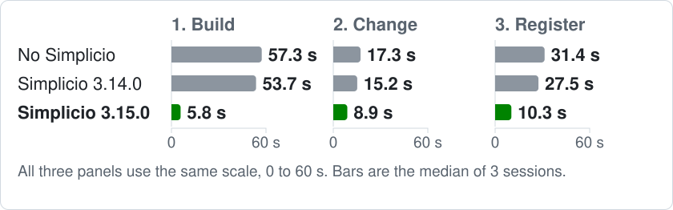

<div align="center">


<h1>Simplicio</h1>

<p><b>UltraFast Mode for all.</b></p>

<p><b>Mesmo agente, mesmo modelo, mesma tarefa: 121&nbsp;s&nbsp;→&nbsp;25&nbsp;s, e $0.0226&nbsp;→&nbsp;$0.0076.</b></p>

<p>Sem o Simplicio → com o Simplicio 3.15.0. Mediana de 3 execuções de uma tarefa pequena de programação no Claude Code, com o Claude Haiku 5.5.</p>

<p>O Simplicio roda na sua máquina e adiciona ferramentas ao agente de programação que você já usa.</p>

<p>
  <a href="https://github.com/simpletibr/simplicio/releases/latest"></a>
  <a href="https://simpleti.com.br/simplicio/docs"></a>
  <a href="https://github.com/simpletibr/simplicio/stargazers"></a>
  
</p>

<p>
  <a href="../README.md">English</a> ·
  Português (Brasil) ·
  <a href="README.es-ES.md">Español</a> ·
  <a href="README.fr-FR.md">Français</a> ·
  <a href="README.it-IT.md">Italiano</a> ·
  <a href="README.pl-PL.md">Polski</a> ·
  <a href="README.ru-RU.md">Русский</a> ·
  <a href="README.zh-CN.md">简体中文</a> ·
  <a href="README.ja-JP.md">日本語</a> ·
  <a href="README.ko-KR.md">한국어</a> ·
  <a href="README.hi-IN.md">हिन्दी</a> ·
  <a href="README.ar-SA.md">العربية</a>&lrm; ·
  <a href="README.he-IL.md">עברית</a>&lrm; ·
  <a href="README.id-ID.md">Bahasa Indonesia</a> ·
  <a href="README.ms-MY.md">Bahasa Melayu</a>
</p>

<p align="center"><sub>Este arquivo é uma tradução do <a href="../README.md">README em inglês</a>. Se os dois divergirem, a página em inglês é a referência. As figuras estão em inglês.</sub></p>

</div>

<p align="center">
  <picture>
    <source media="(prefers-color-scheme: dark)" srcset="../assets/benchmark-2026-11-22-dark.svg">
    
  </picture>
</p>

<p align="center">
  <sub>Mediana de 3 sessões de cada configuração (sem o Simplicio, Simplicio 3.14.0 e Simplicio 3.15.0). Claude Haiku 5.5 no Claude Code 2.1.330, 2026-11-22. Todas as configurações entregaram 9 de 9 etapas. A linha fina de cada barra vai da sessão de menor valor até a de maior valor.<br>
  <a href="../benchmarks/2026-11-22-standard-benchmark.md">Método, dados e limites</a></sub>
</p>

<p align="center">
  <sub>Leia junto com isto: uma tarefa pequena, três sessões por configuração, um modelo. As verificações externas cobrem menos do que os prompts pedem. O pico de memória foi maior: 375 MB contra 270 MB. Os builds do Simplicio foram compilados a partir dos commits das versões, com o login desativado.</sub>
</p>

<p align="center">Como o Simplicio chega a esse resultado não é publicado. As medições são publicadas, inclusive as em que ele perde.</p>

<p align="center">
  <b>Experimente:</b> <a href="#install">Instalação</a> · <a href="#first-run">Primeira execução</a><br>
  <a href="#what-simplicio-is">O que é</a> ·
  <a href="#the-measurement">Medição</a> ·
  <a href="#works-with-the-agent-you-already-use">Agentes</a> ·
  <a href="#command-line">Comandos</a> ·
  <a href="#safety-and-privacy">Privacidade</a> ·
  <a href="#questions-people-ask">Perguntas</a> ·
  <a href="#documentation-and-community">Documentação</a>
</p>

<a id="what-simplicio-is"></a>

## O que é o Simplicio

O Simplicio é um programa local que dá ao agente de programação que você já usa um modo ultrarrápido, seja qual for o agente e seja qual for o modelo. Os números desta página vêm de um único agente e de um único modelo; a seção abaixo diz exatamente o que foi medido.

- **Você mantém o seu agente e o seu modelo.** O Simplicio não substitui o Claude Code, o Codex, o Cursor nem o modelo que estiver por trás deles.
- **Você instala um único binário nativo assinado.** O instalador verifica a assinatura e, em seguida, registra o Simplicio nos agentes que encontra na sua máquina.
- **Ele roda na sua máquina.** O seu agente o inicia como um servidor MCP STDIO local. MCP é o Model Context Protocol, o padrão que um agente de programação usa para chamar ferramentas externas. STDIO significa que o agente executa o próprio programa e conversa com ele pela entrada e saída padrão.
- **Ele dá ferramentas ao seu agente.** Um mapa do repositório, contexto limitado, edições estruturadas e verificações. [As ferramentas principais](#works-with-the-agent-you-already-use) estão listadas abaixo.
- **O que muda é a sessão.** Quanto tempo ela leva e quanto custa. A próxima seção mostra em quanto, e onde não ajuda.

<p align="center">
  <picture>
    <source media="(prefers-color-scheme: dark)" srcset="../assets/diagram-where-simplicio-runs-dark.svg">
    
  </picture>
</p>

<p align="center">
  <sub>A imagem mostra o que acontece por padrão. A lista completa, incluindo os recursos que chegam a outros serviços, está em <a href="#safety-and-privacy">O que o Simplicio envia, e para quem</a>, na seção Segurança e privacidade.</sub>
</p>

<a id="the-measurement"></a>

## A medição

Uma tarefa, executada do mesmo jeito com e sem o Simplicio. A tarefa é uma sessão de agente com três etapas na mesma conversa:

1. Construir uma listagem de usuários: uma API e uma página com tabela, busca e ordenação.
2. Alterá-la: remover uma coluna, adicionar um filtro por papel e uma coluna de data.
3. Adicionar um cadastro simples: um endpoint `POST` que valida os dados recebidos, e uma página com formulário.

Depois de cada etapa, o resultado é verificado de fora da sessão. A API é chamada por HTTP, e as páginas são carregadas no Chrome headless, que é o Chrome sem janela. Todas as configurações usaram o mesmo agente e o mesmo modelo: Claude Code 2.1.330 com Claude Haiku 5.5. A linha de base é o Claude Code 2.1.330 com as próprias ferramentas, sem servidor MCP e sem nenhuma configuração do Simplicio. As verificações não testam a caixa de busca, a ordenação, o redirecionamento depois de salvar, a aparência da página nem a qualidade do código.

Todas as sessões estão neste gráfico, e não apenas as medianas.

<p align="center">
  <picture>
    <source media="(prefers-color-scheme: dark)" srcset="../assets/benchmark-2026-11-22-sessions-dark.svg">
    
  </picture>
</p>

Mediana de 3 sessões por configuração. A linha pequena abaixo de cada valor mostra a sessão de menor valor e a de maior valor.

| Medida | Sem o Simplicio | Simplicio 3.14.0 | Simplicio 3.15.0 |
|---|---|---|---|
| Tempo da tarefa | 121 s<br><sub>97–172</sub> | 104 s<br><sub>90–106</sub> | **25 s**<br><sub>23–27</sub> |
| Custo informado | $0.0226<br><sub>0.0186–0.0280</sub> | $0.0220<br><sub>0.0214–0.0249</sub> | **$0.0076**<br><sub>0.0071–0.0098</sub> |
| Requisições ao modelo | 25<br><sub>19–33</sub> | 18<br><sub>18–22</sub> | **10**<br><sub>10–10</sub> |
| Chamadas de ferramenta | 22<br><sub>16–30</sub> | 15<br><sub>15–19</sub> | **7**<br><sub>7–7</sub> |
| Tokens de saída | 18,162<br><sub>15,599–23,328</sub> | 19,722<br><sub>18,764–24,997</sub> | **3,211**<br><sub>3,068–3,573</sub> |
| Tokens de entrada | 34,691<br><sub>30,447–42,543</sub> | 34,141<br><sub>33,121–40,017</sub> | 18,755<br><sub>18,466–33,300</sub> |
| Tempo de CPU | 8.5 s<br><sub>8.5–9.2</sub> | 10.0 s<br><sub>8.9–10.0</sub> | **5.3 s**<br><sub>5.3–5.5</sub> |
| Pico de memória | **270 MB**<br><sub>248–274</sub> | 436 MB<br><sub>432–439</sub> | 375 MB<br><sub>365–379</sub> |
| Etapas entregues | 9 de 9 | 9 de 9 | 9 de 9 |

Em negrito está o melhor valor de cada linha, apenas quando a faixa dele não se sobrepõe às outras. As faixas de tokens de entrada se sobrepõem, então esta execução não afirma diferença nos tokens de entrada. "9 de 9" são 3 etapas em cada uma das 3 sessões, e todas as etapas passaram em todas as verificações externas. Tempo da tarefa é o tempo de execução da tarefa inteira. Uma requisição ao modelo é uma chamada ao modelo, e uma chamada de ferramenta é um uso de ferramenta feito pelo agente. Custo informado é o que o agente informa: os tokens usados vezes o preço publicado do modelo. Ele conta apenas os tokens do modelo. Não é uma fatura.

O que mudou na sessão, em números: o modelo fez menos requisições, e o agente fez menos chamadas de ferramenta.

<p align="center">
  <picture>
    <source media="(prefers-color-scheme: dark)" srcset="../assets/benchmark-2026-11-22-work-dark.svg">
    
  </picture>
</p>

Tempo por etapa, em uma escala comum.

<p align="center">
  <picture>
    <source media="(prefers-color-scheme: dark)" srcset="../assets/benchmark-2026-11-22-steps-dark.svg">
    
  </picture>
</p>

Cada mediana é calculada separadamente, então as etapas não somam a mediana da tarefa inteira.

<details>
<summary>Números exatos por etapa</summary>

Cada célula traz a mediana do tempo e a mediana do custo da etapa:

| Etapa | Sem o Simplicio | Simplicio 3.14.0 | Simplicio 3.15.0 |
|---|---|---|---|
| 1. Construção | 57.3 s / $0.0111 | 53.7 s / $0.0137 | 5.8 s / $0.0022 |
| 2. Alteração | 17.3 s / $0.0040 | 15.2 s / $0.0032 | 8.9 s / $0.0023 |
| 3. Cadastro | 31.4 s / $0.0075 | 27.5 s / $0.0056 | 10.3 s / $0.0026 |

</details>

**Como ler.** As proporções vêm das medianas sem arredondamento. Em comparação com o mesmo agente sem o Simplicio, a tarefa inteira rodou 4.9 vezes mais rápido e custou cerca de um terço. Em comparação com a versão anterior, rodou 4.2 vezes mais rápido. Na sessão, o modelo fez 10 requisições em vez de 25 e gerou 3,211 tokens de saída em vez de 18,162, e a tarefa passou nas mesmas verificações externas. Pior caso: a sessão mais rápida sem o Simplicio (97.1 s) ainda foi 3.7 vezes mais lenta do que a sessão mais lenta com o Simplicio 3.15.0 (26.6 s), e a sessão mais barata sem ele ($0.0186) ainda custou 1.9 vezes o que custou a sessão mais cara com ele ($0.0098). A linha de base é o Claude Code 2.1.330 com as próprias ferramentas, sem servidor MCP e sem nenhuma configuração do Simplicio. O custo conta apenas os tokens do modelo. As sessões rodaram quatro por vez em uma máquina, então compare os tempos somente dentro desta rodada.

<a id="where-simplicio-does-not-win"></a>

### Onde o Simplicio não vence

<p align="center">
  <picture>
    <source media="(prefers-color-scheme: dark)" srcset="../assets/benchmark-2026-11-22-memory-dark.svg">
    
  </picture>
</p>

- **Memória.** O pico de memória foi 39% maior do que com o agente puro: 375 MB contra 270 MB.
- **A versão anterior não mostrou ganho nesta tarefa.** O Simplicio 3.14.0 custou o mesmo que sem o Simplicio, e a diferença de tempo dele está dentro da variação entre execuções. O ganho desta página veio com a versão 3.15.0.
- **Um script Python curto e pontual.** Em uma rodada anterior, o Simplicio 3.10.8 foi mais lento do que o agente puro com todos os modelos testados. No Claude Sonnet 5.5 no Claude Code, levou 19.6 s e $0.0548, contra 11.4 s e $0.0283 sem ele. Essa tarefa não foi medida de novo na versão 3.15.0.
- **O que você instala não é exatamente o que foi medido.** Os builds foram compilados a partir dos commits das versões, com o login desativado e o processo em segundo plano desativado. Os downloads assinados não foram medidos.
- **A amostra é pequena.** Três sessões por configuração, um modelo, um projeto novo e pequeno, uma máquina, quatro sessões ao mesmo tempo. Leia as proporções como uma medição desta tarefa, e não como uma promessa para a sua. Nenhuma sessão dessas três configurações foi descartada nem executada de novo. Não medimos quanto do seu trabalho se parece com esta tarefa.

### Confira por conta própria

[O relatório](../benchmarks/2026-11-22-standard-benchmark.md) publica os três prompts (em português, com uma tradução), a descrição de cada verificação externa e os números de cada sessão; [o arquivo de dados](../benchmarks/2026-11-22-standard-benchmark.json) traz esses dados em JSON. O harness de testes não é publicado. Execute os mesmos três prompts no seu próprio agente, com o Simplicio ligado e desligado, em um projeto pequeno seu, e compare os seus tempos e os seus gastos.

<a id="install"></a>

## Instalação

Instale o binário nativo assinado. Escolha uma das opções.

macOS / Linux:

```bash
curl -fsSL https://raw.githubusercontent.com/simpletibr/simplicio/master/install.sh | sh
```

Windows (PowerShell):

```powershell
irm https://raw.githubusercontent.com/simpletibr/simplicio/master/install.ps1 | iex
```

Python (PyPI):

```bash
python3 -m pip install --upgrade simplicio-installer
simplicio install
```

No Windows, use `py -m pip install --upgrade simplicio-installer` e depois `simplicio install`. Se o diretório de scripts do Python não estiver no seu `PATH`, adicione-o antes.

O instalador baixa a versão assinada mais recente para a sua plataforma e verifica o SHA-256 e a assinatura Ed25519 dela. Só depois disso ele substitui o binário instalado. O binário fica em `~/.simplicio/bin/` (no Windows, `%USERPROFILE%\.simplicio\bin\`), e o Simplicio é registrado automaticamente nos agentes que o instalador encontrar. Se o registro falhar, o instalador para, em vez de informar sucesso. Reinicie qualquer agente que já esteja aberto para que ele recarregue a configuração.

**Fazer login.** É necessário fazer login com o Google, inclusive durante o beta. Execute `simplicio auth login` e depois `simplicio auth status --json`, e continue quando o status indicar `active: true`. O registro não depende de login, então os agentes ficam configurados mesmo antes de você fazer login. Nunca cole senha ou token na configuração de um agente.

<details>
<summary>Verificar, atualizar, remover</summary>

Para atualizar, execute o instalador de novo. Você pode executar qualquer um dos dois instaladores novamente a qualquer momento, e ele obtém a versão mais recente. `install.sh` e `install.ps1` ficam na raiz deste repositório.

```bash
# macOS / Linux
sh install.sh --doctor
sh install.sh --uninstall --keep-data
sh install.sh --uninstall --purge       # needs SIMPLICIO_CONFIRM_PURGE=1; preserves ~/.simplicio/.env
```

```powershell
# Windows
pwsh install.ps1 -Doctor
pwsh install.ps1 -Uninstall -KeepData
pwsh install.ps1 -Uninstall -Purge      # needs SIMPLICIO_CONFIRM_PURGE=1; preserves .env
```

- `--doctor` verifica a instalação.
- `--uninstall --keep-data` remove o binário instalado e mantém os seus dados. Isso inclui o estado do login com o Google, de 30 dias, em `~/.simplicio/login.json`.
- `--uninstall --purge` remove somente o estado que o Simplicio gerencia, incluindo o estado do login. Ele mantém `~/.simplicio/.env`, onde podem ficar as credenciais dos provedores. A purga exige `SIMPLICIO_CONFIRM_PURGE=1`.
- A desinstalação não edita a configuração dos seus agentes. As entradas do Simplicio permanecem em cada agente até você removê-las nas configurações próprias desse agente.
- Os dados dentro da pasta `.simplicio` de um projeto não são removidos por `--keep-data`. Verifique o destino antes de escolher `--purge`.

Detalhes completos: [INSTALL.md](../INSTALL.md).

</details>

<a id="first-run"></a>

## Primeira execução

```bash
simplicio version
cd my-project
simplicio onboard
```

`simplicio version` confirma o binário instalado. `simplicio onboard` prepara o projeto na primeira vez. Depois, abra o seu agente nesse projeto e trabalhe normalmente. Para confirmar que o Simplicio carregou, procure por `simplicio` na lista de servidores MCP do agente. No Claude Code, `/mcp` lista os servidores conectados. Prefere ler o instalador antes? Ele está em [install.sh](../install.sh).

<a id="works-with-the-agent-you-already-use"></a>

## Funciona com o agente que você já usa

O Simplicio é um servidor MCP STDIO local, então qualquer agente que consiga iniciar um servidor MCP local pode ser apontado para ele.

O instalador delega o registro ao módulo de registro do próprio Simplicio. Ele detecta os agentes na sua máquina e grava a entrada do Simplicio nos que sabe configurar, entre eles Claude Code, Codex, Cursor, Visual Studio Code, OpenCode, Gemini CLI e Kiro. Dois arquivos deste repositório mostram até onde vai cada integração:

- O catálogo [`plugins/simplicio/host-surfaces.json`](../plugins/simplicio/host-surfaces.json) lista 43 IDs de agentes e informa, para cada um, como o Simplicio chega até ele: uma entrada MCP que o Simplicio grava (23), um plugin ou extensão nativa (5), um pacote de plugin portátil (4), uma configuração guiada que você segue por conta própria (9) ou outra ferramenta de linha de comando (2).
- A matriz de compatibilidade [`docs/hosts/compatibility-matrix.md`](../docs/hosts/compatibility-matrix.md) diz o que foi verificado. Dos 43, ela marca 12 agentes como suportados e 29 como `unverified`, e não tem linha para o Codex nem para o Gemini CLI. Quando o catálogo diz que o Simplicio grava a entrada e a matriz diz `unverified`, trate essa integração como não testada.

23 agentes têm um guia em [`docs/hosts/`](../docs/hosts/). Nos agentes alcançados por meio de um plugin, o plugin é aplicado em uma etapa separada que pede o seu consentimento, e o [INSTALL.md](../INSTALL.md) descreve essa etapa.

<details>
<summary>Todos os 43 agentes, conforme o modo como o Simplicio os alcança</summary>

| Como o Simplicio alcança o agente | Quantidade | Agentes |
|---|---|---|
| Uma entrada MCP que o Simplicio grava | 23 | **xAI Grok Build**, MiMo Code, Amp, OpenClaude, Antigravity, **Pi**, **oh-my-pi**, Goose, Auggie, Autohand Code, Charm, Cline, Command Code, Continue, Droid, Kilocode, Kimi, Mistral Vibe, Rovo Dev, **Visual Studio Code**, **Meta Muse Code**, **OpenMausBot**, **OpenMuse (Python)** |
| Um plugin ou extensão nativa | 5 | **Claude Code**, Codex, **OpenCode**, Hermes Agent, Gemini CLI |
| Um pacote de plugin portátil | 4 | **Cursor**, GitHub Copilot, **Kiro**, Qwen Code |
| Uma configuração guiada que você segue por conta própria | 9 | Devin, Codebuff, CopilotKit OpenDots, CopilotKit OpenBot, agentes.chat, OpenAI dots, xAI Grok Bot, Meta Muse app, Cue by Manus |
| Outra ferramenta de linha de comando | 2 | **OrcaDev / Orca ADE**, T3 Code |

Em negrito: a matriz de compatibilidade marca o agente como suportado.

</details>

Para repetir o registro, execute `simplicio mcp register`. O comando do servidor é `simplicio serve --mcp --stdio`. Estas são as ferramentas principais que o seu agente recebe:

| Ferramenta | O que ela oferece |
|---|---|
| `simplicio_map` | Um mapa compacto do repositório, para o agente se orientar |
| `simplicio_context` | O contexto que uma tarefa precisa, limitado, em vez de arquivos inteiros |
| `simplicio_edit` | Edições estruturadas de arquivos a partir de um plano preparado |
| `simplicio_validate` | Verificações de pipeline, de testes e de entrega |
| `simplicio_run` | Uma execução de tarefa sob controle do Simplicio |

A lista atual é a que o servidor informa ao iniciar. O [MCP-CONNECT.md](../MCP-CONNECT.md) descreve as ferramentas principais.

<details>
<summary>Configuração manual</summary>

Se o seu agente não foi configurado automaticamente, adicione esta entrada à configuração MCP dele. Substitua o caminho pelo caminho absoluto do binário instalado.

```json
{
  "mcpServers": {
    "simplicio": {
      "command": "/absolute/path/to/.simplicio/bin/simplicio",
      "args": ["serve", "--mcp", "--stdio"]
    }
  }
}
```

O Codex lê TOML. Os agentes iniciam `command` diretamente, então não use `~` nem dependa da expansão do shell. Use barras normais nos caminhos do Windows e troque o nome de usuário de exemplo.

Windows:

```toml
[mcp_servers.simplicio]
command = "C:/Users/YourName/.simplicio/bin/simplicio.exe"
args = ["serve", "--mcp", "--stdio"]
```

macOS:

```toml
[mcp_servers.simplicio]
command = "/Users/your-name/.simplicio/bin/simplicio"
args = ["serve", "--mcp", "--stdio"]
```

Linux:

```toml
[mcp_servers.simplicio]
command = "/home/your-name/.simplicio/bin/simplicio"
args = ["serve", "--mcp", "--stdio"]
```

Onde cada agente guarda o seu arquivo: [MCP-CONNECT.md](../MCP-CONNECT.md).

</details>

<a id="command-line"></a>

## Linha de comando

| Comando | O que você obtém |
|---|---|
| `simplicio map --repo . --for-llm markdown` | Um mapa estrutural compacto do repositório, escrito para um modelo ler |
| `simplicio context --repo .` | O contexto limitado de uma tarefa |
| `simplicio memory query "query" --json` | O que o projeto já sabe, recuperado da memória indexada dele, em JSON |
| `simplicio edit --plan plan.json --repo .` | Um conjunto preparado de edições estruturadas, aplicado aos arquivos |
| `simplicio run "task" --repo . --agents N` | Uma execução de tarefa com N agentes sob controle do Simplicio |
| `simplicio loop` | Trabalho que segue em rodadas até convergir |

Os nomes que você verá nas mensagens do Simplicio: Mapper observa, Fast projeta ou recupera, Dev CLI edita, Runtime governa e Loop converge.

<a id="safety-and-privacy"></a>

## Segurança e privacidade

Esta seção descreve a versão 3.15.0.

**O que o Simplicio envia, e para quem**

- **Fica na sua máquina.** O mapeamento, o contexto, as edições e as verificações rodam dentro do binário do Simplicio. Ele entrega os resultados ao seu agente na mesma máquina. O que o seu agente envia ao próprio provedor de modelo é decidido pelo agente, como antes.
- **Para a SimpleTI (simpleti.com.br).** Somente verificações de login e de plano. Elas levam o seu token de login, a versão do Simplicio e o nome do host do seu computador. Uma consulta de licença opcional também leva o e-mail da sua conta. Elas devolvem o e-mail, o nome e o plano da sua conta. Nenhum conteúdo de repositório: nenhum arquivo, nenhum caminho de arquivo, nenhum prompt e nenhuma edição.
- **Para o GitHub.** Uma verificação em segundo plano por nova versão, no máximo cerca de uma vez a cada 12 horas. Ela não leva nada sobre você nem sobre o seu código. Defina `SIMPLICIO_DISABLE_AUTO_UPDATE=1` para desligá-la. Ao atualizar, o novo binário é baixado do GitHub, e o SHA-256 e a assinatura dele são verificados antes de substituir o antigo.
- **Sem analytics.** O Simplicio 3.15.0 e os arquivos que ele instala nos seus agentes foram verificados para isso: nenhum envia analytics, relatórios de falhas ou dados de uso. Os registros de uso e de economia são arquivos locais. Os hooks que ele instala executam somente programas locais (o binário do Simplicio e, para os plugins opcionais, scripts locais); nenhum deles acessa a rede.
- **Para serviços que você configura.** Um provedor de modelo, o GitHub, o Jira, um notificador de chat ou um cache de equipe recebem o que aquele recurso envia, o que pode incluir prompts e código. As requisições a um provedor de modelo levam um cabeçalho que identifica o Simplicio como cliente.
- **Dois recursos chegam a um serviço aberto ao público na internet sem nenhuma configuração.** A busca na web, quando é executada, envia a consulta de busca ao DuckDuckGo, a menos que você configure outro serviço de busca. No chat próprio do Simplicio, uma mensagem que pareça uma pergunta sobre a web pode virar essa consulta. A auditoria de segurança das dependências, quando você a executa, envia os nomes e as versões das suas dependências ao osv.dev. Nenhum dos dois envia conteúdo de arquivos.
- **Downloads.** O instalador e o caminho de atualização baixam do GitHub. Alguns scripts auxiliares opcionais buscam as próprias ferramentas no PyPI ou no npm quando você os executa. Se um plugin de agente iniciar e não encontrar o binário do Simplicio, ele baixa o instalador oficial do GitHub, fixado em um commit e verificado por SHA-256.

**Versões assinadas.** Cada versão publica os seus binários com somas de verificação SHA-256, assinaturas Ed25519, um SBOM (uma lista do que está no build) e a proveniência do build. Os instaladores e o caminho de atualização verificam a soma e a assinatura antes de substituir o binário instalado. Para as versões estáveis, o contrato trata como falha grave uma assinatura ausente ou inválida e uma soma de verificação divergente. O contrato está em [docs/UPDATE_SIGNATURE_CONTRACT.md](../docs/UPDATE_SIGNATURE_CONTRACT.md).

**O que o instalador altera no seu agente.** Ele adiciona uma entrada do Simplicio à configuração MCP do agente e mantém o restante da configuração. No Claude Code, também libera `mcp__simplicio__*`, para que nenhuma ferramenta do Simplicio seja negada no modo automático. Nos agentes cuja interface de hooks o instalador tenha verificado, ele também instala os hooks do Simplicio ali. O [INSTALL.md](../INSTALL.md) diz o que o instalador grava, e o guia de cada agente em [`docs/hosts/`](../docs/hosts/) traz o detalhe. A desinstalação não desfaz essas entradas. A seção Instalação explica como removê-las.

## Também neste repositório

<details>
<summary>Aplicativo de desktop (prévia para macOS)</summary>

Uma prévia do Desktop para macOS (Apple Silicon) é publicada como [Simplicio-3.8.47-arm64.dmg](https://github.com/simpletibr/simplicio/releases/download/v3.8.47/Simplicio-3.8.47-arm64.dmg). O SHA-256 dela está em [DESKTOP-SHA256SUMS](../DESKTOP-SHA256SUMS), separado das somas de verificação dos binários do Simplicio. O DMG não tem arquivo de assinatura e inclui o binário do Simplicio 3.8.47.

- O Desktop para Windows não é publicado. No Windows, use a instalação pela linha de comando acima.
- A assinatura com Apple Developer ID e a notarização não foram feitas. O pacote tem assinatura ad-hoc, ou seja, sem certificado de desenvolvedor da Apple, e não há afirmação de aceitação pelo Gatekeeper, então o macOS pode mostrar um aviso quando você o abrir.
- A instalação pela linha de comando acima é o caminho público e suportado até que um pacote assinado do Desktop seja publicado.

Detalhes: [docs/desktop/RELEASE.md](../docs/desktop/RELEASE.md).

</details>

<details>
<summary>Para mantenedores: o diagrama de fluxo gerado</summary>

Os comandos e as ferramentas documentados no README.md e no MCP-CONNECT.md são representados em um único fluxo, [docs/flow/simplicio.svg](../docs/flow/simplicio.svg), gerado a partir de um arquivo fonte, `docs/flow/simplicio.flow.json`. Gere de novo com `python3 scripts/generate_flow.py` e verifique se há divergência com `python3 scripts/generate_flow.py --check`. O contrato que mantém o fluxo em sintonia com esta página e com o MCP-CONNECT.md é `python3 -m pytest tests/test_flow_contract.py -q`. A verificação de importação no Langflow é `scripts/verify_flow_langflow.py`, que falha de forma fechada (saída 2, `status=blocked`) quando nenhum servidor está em execução. As evidências ficam em `docs/flow/evidence/` e `docs/flow/render/`, e [docs/flow/README.md](../docs/flow/README.md) traz os requisitos e como repetir o processo.

</details>

<a id="questions-people-ask"></a>

## Perguntas frequentes

**A comparação é justa?**<br>
O mesmo agente, o mesmo modelo, os mesmos três prompts, o mesmo projeto inicial e as mesmas verificações externas, em uma única rodada. A linha de base não tem servidor MCP e não tem configuração do Simplicio. Veja [Onde o Simplicio não vence](#where-simplicio-does-not-win) e os [Limites](../benchmarks/2026-11-22-standard-benchmark.md#limits) do relatório.

**Preciso trocar de agente ou de modelo?**<br>
Não. O Simplicio se conecta ao agente que você já usa. No benchmark acima, todas as configurações usaram o mesmo agente e o mesmo modelo.

**Eu sempre vou ter esses números?**<br>
Não. Eles medem uma tarefa, com um modelo, em uma máquina, em três sessões por configuração. Veja [Onde o Simplicio não vence](#where-simplicio-does-not-win) e rode a comparação com o seu próprio trabalho.

**É código aberto?**<br>
Não. O Simplicio é proprietário. É um binário assinado, publicado como arquivos das versões, e o código-fonte não é público. Este repositório reúne os instaladores, os pacotes para os agentes, o código-fonte do aplicativo de Desktop, a documentação e os dados do benchmark.

**Como removo?**<br>
Execute `sh install.sh --uninstall --keep-data`, ou `pwsh install.ps1 -Uninstall -KeepData` no Windows. Ele remove o binário e mantém os seus dados. Ele não edita a configuração dos seus agentes, então remova as entradas do Simplicio nas configurações de cada agente. Em [Instalação](#install) estão os detalhes e a opção de purga.

**Preciso de uma conta?**<br>
Sim. É necessário fazer login com o Google, inclusive durante o beta. Execute `simplicio auth login`.

**O meu código sai da minha máquina?**<br>
Mapeamento, contexto, edições e verificações rodam na sua máquina. O Simplicio conversa com a SimpleTI para verificações de login e de plano, e com o GitHub para procurar atualizações, sem conteúdo de repositório em nenhum dos dois. Os recursos que você configura ou executa podem chegar a outros serviços. A lista completa está em [O que o Simplicio envia, e para quem](#safety-and-privacy).

<a id="documentation-and-community"></a>

## Documentação e comunidade

- **Site:** [simpleti.com.br/simplicio](https://simpleti.com.br/simplicio/)
- **Documentação:** [simpleti.com.br/simplicio/docs](https://simpleti.com.br/simplicio/docs)
- **Discord:** [Entre na comunidade](https://discord.gg/wM6tr7xVb)
- **Issues:** [Rastreador de issues do GitHub](https://github.com/simpletibr/simplicio/issues)
- **Neste repositório:** [INSTALL.md](../INSTALL.md), [MCP-CONNECT.md](../MCP-CONNECT.md) e [docs/hosts/](../docs/hosts/)
- **Relacionado:** Simplicio Video (hypit). Para clonar: `git clone https://github.com/hypit-ai/hypit.git simplicio-video`

<p align="center">
  <sub>© 2026 SimpleTI. O Simplicio é um software proprietário registrado. Todos os direitos reservados.</sub>
</p>
