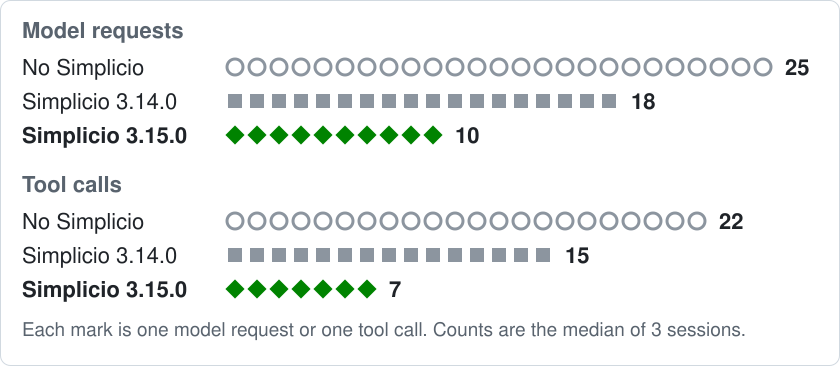

<div align="center">


<h1>Simplicio</h1>

<p><b>UltraFast Mode for all.</b></p>

<p><b>Тот же агент, та же модель, та же задача: 121&nbsp;s&nbsp;→&nbsp;25&nbsp;s и $0.0226&nbsp;→&nbsp;$0.0076.</b></p>

<p>Без Simplicio → с Simplicio 3.15.0. Медиана по 3 запускам одной небольшой задачи по написанию кода в Claude Code с Claude Haiku 5.5.</p>

<p>Simplicio работает на вашем компьютере и добавляет инструменты к агенту для программирования, который вы уже используете.</p>

<p>
  <a href="https://github.com/simpletibr/simplicio/releases/latest"></a>
  <a href="https://simpleti.com.br/simplicio/docs"></a>
  <a href="https://github.com/simpletibr/simplicio/stargazers"></a>
  
</p>

<p>
  <a href="../README.md">English</a> ·
  <a href="README.pt-BR.md">Português (Brasil)</a> ·
  <a href="README.es-ES.md">Español</a> ·
  <a href="README.fr-FR.md">Français</a> ·
  <a href="README.it-IT.md">Italiano</a> ·
  <a href="README.pl-PL.md">Polski</a> ·
  Русский ·
  <a href="README.zh-CN.md">简体中文</a> ·
  <a href="README.ja-JP.md">日本語</a> ·
  <a href="README.ko-KR.md">한국어</a> ·
  <a href="README.hi-IN.md">हिन्दी</a> ·
  <a href="README.ar-SA.md">العربية</a>&lrm; ·
  <a href="README.he-IL.md">עברית</a>&lrm; ·
  <a href="README.id-ID.md">Bahasa Indonesia</a> ·
  <a href="README.ms-MY.md">Bahasa Melayu</a>
</p>

<p align="center"><sub>Это перевод <a href="../README.md">английской версии README</a>. Если тексты расходятся, эталоном считается английская страница. Графики и подписи на них приведены на английском языке.</sub></p>

</div>

<p align="center">
  <picture>
    <source media="(prefers-color-scheme: dark)" srcset="../assets/benchmark-2026-11-22-dark.svg">
    
  </picture>
</p>

<p align="center">
  <sub>Медиана по 3 сессиям для каждой настройки (без Simplicio, Simplicio 3.14.0 и Simplicio 3.15.0). Claude Haiku 5.5 в Claude Code 2.1.330, 2026-11-22. Каждая настройка выполнила 9 из 9 шагов. Тонкая линия на каждом столбце показывает диапазон от самой низкой до самой высокой сессии.<br>
  <a href="../benchmarks/2026-11-22-standard-benchmark.md">Метод, данные и ограничения</a></sub>
</p>

<p align="center">
  <sub>Читайте вместе с этим: одна небольшая задача, три сессии на настройку, одна модель. Внешние проверки охватывают меньше, чем требуют промпты. Пиковая память была выше: 375 MB против 270 MB. Сборки Simplicio собраны из коммитов релиза, с отключённым входом в аккаунт.</sub>
</p>

<p align="center">То, как Simplicio получает этот результат, не публикуется. Замеры опубликованы, в том числе те, в которых Simplicio проигрывает.</p>

<p align="center">
  <b>Попробуйте:</b> <a href="#install">Установка</a> · <a href="#first-run">Первый запуск</a><br>
  <a href="#what-simplicio-is">Что это</a> ·
  <a href="#the-measurement">Измерение</a> ·
  <a href="#works-with-the-agent-you-already-use">Агенты</a> ·
  <a href="#command-line">Команды</a> ·
  <a href="#safety-and-privacy">Конфиденциальность</a> ·
  <a href="#questions-people-ask">Вопросы</a> ·
  <a href="#documentation-and-community">Документация</a>
</p>

<a id="what-simplicio-is"></a>

## Что такое Simplicio

Simplicio это локальная программа, которая даёт уже используемому вами агенту для программирования сверхбыстрый режим, каким бы ни был агент и какой бы ни была модель. Числа на этой странице получены от одного агента и одной модели; раздел ниже точно описывает, что именно измерялось.

- **Агент и модель остаются вашими.** Simplicio не заменяет Claude Code, Codex, Cursor или модель, которая стоит за ними.
- **Один подписанный бинарный файл** регистрируется в ваших агентах и работает на вашем компьютере как локальный MCP-сервер STDIO.
- **Меняется сама сессия.** Её время и её стоимость.

<p align="center">
  <picture>
    <source media="(prefers-color-scheme: dark)" srcset="../assets/diagram-where-simplicio-runs-dark.svg">
    
  </picture>
</p>

<p align="center">
  <sub>Поток по умолчанию. <a href="#safety-and-privacy">Полный список</a> включает остальные сервисы.</sub>
</p>

<details>
<summary>MCP и STDIO</summary>

MCP это Model Context Protocol, способ, которым агент для программирования вызывает внешние инструменты. STDIO означает, что агент сам запускает программу и общается с ней через её стандартный ввод и вывод.

Он даёт агенту инструменты. Карта репозитория, ограниченный контекст, структурированные правки и проверки. [Основные инструменты](#works-with-the-agent-you-already-use) перечислены ниже.

Вы устанавливаете один подписанный нативный бинарный файл. Установщик проверяет подпись, затем регистрирует Simplicio в агентах, которые находит на вашем компьютере.

</details>

<a id="the-measurement"></a>

## Измерение

Одна задача, выполняемая одинаково с Simplicio и без него: три шага в одной сессии агента, и каждый результат проверяется снаружи сессии.

1. Построить список пользователей: API и страницу с таблицей, поиском и сортировкой.
2. Изменить его: убрать столбец, добавить фильтр по роли и столбец с датой.
3. Добавить регистрацию: эндпоинт `POST`, который проверяет входные данные, и страницу с формой.

<p align="center">
  <picture>
    <source media="(prefers-color-scheme: dark)" srcset="../assets/benchmark-2026-11-22-sessions-dark.svg">
    
  </picture>
</p>

| Показатель | Без Simplicio | Simplicio 3.14.0 | Simplicio 3.15.0 |
|---|---|---|---|
| Время задачи | 121 s<br><sub>97–172</sub> | 104 s<br><sub>90–106</sub> | **25 s**<br><sub>23–27</sub> |
| Стоимость по данным агента | $0.0226<br><sub>0.0186–0.0280</sub> | $0.0220<br><sub>0.0214–0.0249</sub> | **$0.0076**<br><sub>0.0071–0.0098</sub> |
| Запросы к модели | 25<br><sub>19–33</sub> | 18<br><sub>18–22</sub> | **10**<br><sub>10–10</sub> |
| Вызовы инструментов | 22<br><sub>16–30</sub> | 15<br><sub>15–19</sub> | **7**<br><sub>7–7</sub> |
| Выходные токены | 18,162<br><sub>15,599–23,328</sub> | 19,722<br><sub>18,764–24,997</sub> | **3,211**<br><sub>3,068–3,573</sub> |
| Входные токены | 34,691<br><sub>30,447–42,543</sub> | 34,141<br><sub>33,121–40,017</sub> | 18,755<br><sub>18,466–33,300</sub> |
| Время ЦП | 8.5 s<br><sub>8.5–9.2</sub> | 10.0 s<br><sub>8.9–10.0</sub> | **5.3 s**<br><sub>5.3–5.5</sub> |
| Пиковая память | **270 MB**<br><sub>248–274</sub> | 436 MB<br><sub>432–439</sub> | 375 MB<br><sub>365–379</sub> |
| Выполнено шагов | 9 из 9 | 9 из 9 | 9 из 9 |

Медиана по 3 сессиям; под каждым значением указана самая низкая и самая высокая сессия. Жирным отмечено лучшее значение в строке, где диапазоны не пересекаются. «9 из 9» означает 3 шага в каждой из 3 сессий, и каждый шаг прошёл все внешние проверки.

Запросы к модели и вызовы инструментов на одну сессию.

<p align="center">
  <picture>
    <source media="(prefers-color-scheme: dark)" srcset="../assets/benchmark-2026-11-22-work-dark.svg">
    
  </picture>
</p>

Время по шагам, на одной общей шкале.

<p align="center">
  <picture>
    <source media="(prefers-color-scheme: dark)" srcset="../assets/benchmark-2026-11-22-steps-dark.svg">
    
  </picture>
</p>

<details>
<summary>Точные значения по шагам</summary>

В каждой ячейке медианное время и медианная стоимость шага:

| Шаг | Без Simplicio | Simplicio 3.14.0 | Simplicio 3.15.0 |
|---|---|---|---|
| 1. Создание | 57.3 s / $0.0111 | 53.7 s / $0.0137 | 5.8 s / $0.0022 |
| 2. Изменение | 17.3 s / $0.0040 | 15.2 s / $0.0032 | 8.9 s / $0.0023 |
| 3. Регистрация | 31.4 s / $0.0075 | 27.5 s / $0.0056 | 10.3 s / $0.0026 |

</details>

**Как читать.** Вся задача выполнилась в 4.9 раза быстрее при примерно трети стоимости; даже самая быстрая сессия без Simplicio (97.1 s) была в 3.7 раза медленнее самой медленной с 3.15.0 (26.6 s). [Метод, ограничения](../benchmarks/2026-11-22-standard-benchmark.md#limits)

<details>
<summary>Как определяется каждое число</summary>

- Соотношения посчитаны по медианам без округления. По сравнению с предыдущим релизом вся задача выполнилась в 4.2 раза быстрее.
- Каждая медиана считается отдельно, поэтому шаги не складываются в медиану всей задачи.
- Худший случай: самая быстрая сессия без Simplicio (97.1 s) всё равно была в 3.7 раза медленнее самой медленной сессии с Simplicio 3.15.0 (26.6 s), а самая дешёвая сессия без него ($0.0186) всё равно стоила в 1.9 раза больше самой дорогой сессии с ним ($0.0098).
- Базовый уровень это Claude Code 2.1.330 со своими инструментами, без MCP-сервера и без настройки Simplicio.
- Каждый шаг проверяется снаружи сессии: к API обращаются по HTTP, а страницы открываются в headless-Chrome, то есть в Chrome без окна.
- Проверки не тестируют поле поиска, сортировку, переход после сохранения, внешний вид страницы и качество кода.
- Запрос к модели это один вызов модели; вызов инструмента это одно использование инструмента агентом.
- Стоимость по данным агента это использованные токены, умноженные на опубликованную цену модели. Учитываются только токены модели. Это не счёт.
- Диапазоны входных токенов перекрываются, поэтому этот замер не утверждает никакой разницы во входных токенах.
- Сессии шли по четыре одновременно на одной машине: сравнивать времена можно только внутри этого раунда.

</details>

<a id="where-simplicio-does-not-win"></a>

### Где Simplicio не выигрывает

<p align="center">
  <picture>
    <source media="(prefers-color-scheme: dark)" srcset="../assets/benchmark-2026-11-22-memory-dark.svg">
    
  </picture>
</p>

- **Память.** Пиковая память была на 39% выше: 375 MB против 270 MB.
- **Предыдущий релиз не дал выигрыша в этой задаче.** Simplicio 3.14.0 стоил столько же, сколько без Simplicio.
- **Короткий разовый скрипт на Python.** Simplicio 3.10.8 был медленнее (19.6 s против 11.4 s) и не измерялся повторно.
- **Установленное не в точности то, что измерялось.** Сборки компилировались из коммитов релиза, с отключённым входом в аккаунт.
- **Выборка мала.** Три сессии на настройку, одна модель, один проект.

<details>
<summary>Все ограничения</summary>

- **Память.** Пиковая память была на 39% выше, чем у обычного агента: 375 MB против 270 MB.
- **Предыдущий релиз не дал выигрыша в этой задаче.** Simplicio 3.14.0 стоил столько же, сколько без Simplicio, а разница по времени укладывается в разброс между запусками. Выигрыш появился в 3.15.0.
- **Короткий разовый скрипт на Python.** В более раннем раунде Simplicio 3.10.8 был медленнее обычного агента на каждой из проверенных моделей: на Claude Sonnet 5.5 в Claude Code 19.6 s и $0.0548 против 11.4 s и $0.0283. На 3.15.0 не измерялся повторно.
- **Установленное не в точности то, что измерялось.** Сборки компилировались из коммитов релиза, с отключёнными входом в аккаунт и фоновым процессом. Подписанные загрузки не измерялись.
- **Выборка мала.** Три сессии на настройку, одна модель, один небольшой новый проект, одна машина, четыре сессии одновременно; ни одна не отброшена и не перезапущена. Соотношения измеряют эту задачу, а не вашу, и мы не измеряли, насколько ваша работа на неё похожа.

</details>

### Проверьте сами

[Отчёт](../benchmarks/2026-11-22-standard-benchmark.md) публикует три промпта (на португальском, с переводом), каждую внешнюю проверку и каждую сессию; [файл данных](../benchmarks/2026-11-22-standard-benchmark.json) содержит то же в формате JSON. Тестовый стенд не публикуется.

<a id="install"></a>

## Установка

macOS / Linux:

```bash
curl -fsSL https://raw.githubusercontent.com/simpletibr/simplicio/master/install.sh | sh
```

Windows (PowerShell):

```powershell
irm https://raw.githubusercontent.com/simpletibr/simplicio/master/install.ps1 | iex
```

Python (PyPI):

```bash
python3 -m pip install --upgrade simplicio-installer
simplicio install
```

В Windows используйте `py -m pip install --upgrade simplicio-installer`, а затем `simplicio install`.

Установщик проверяет подписанный релиз и автоматически регистрирует Simplicio в найденных агентах. Затем выполните вход командой `simplicio auth login`.

<details>
<summary>Подробности установки</summary>

- Установщик скачивает последний подписанный релиз для вашей платформы и проверяет его SHA-256 и подпись Ed25519, прежде чем заменить установленный бинарный файл.
- Бинарный файл кладётся в `~/.simplicio/bin/` (в Windows: `%USERPROFILE%\.simplicio\bin\`), и Simplicio автоматически регистрируется в найденных агентах. Ошибка регистрации останавливает установщик, а не выдаёт успех.
- Перезапустите уже открытые агенты, чтобы они перечитали конфигурацию. Если каталог скриптов Python не входит в `PATH`, сначала добавьте его.

**Вход в аккаунт.** Нужен вход через Google, в том числе во время бета-версии. Выполните `simplicio auth login`, затем `simplicio auth status --json`, и продолжайте, когда команда покажет `active: true`. Регистрация работает и до входа. Никогда не вставляйте пароль или токен в конфигурацию агента.

Чтобы проверить, что Simplicio загрузился, найдите `simplicio` в списке MCP-серверов агента. В Claude Code `/mcp` показывает подключённые серверы. Предпочитаете сначала прочитать установщик? Это [install.sh](../install.sh).

Чтобы обновиться, запустите любой из установщиков снова в любое время: он находит последний релиз. `install.sh` и `install.ps1` лежат в корне этого репозитория.

```bash
# macOS / Linux
sh install.sh --doctor
sh install.sh --uninstall --keep-data
sh install.sh --uninstall --purge       # needs SIMPLICIO_CONFIRM_PURGE=1; preserves ~/.simplicio/.env
```

```powershell
# Windows
pwsh install.ps1 -Doctor
pwsh install.ps1 -Uninstall -KeepData
pwsh install.ps1 -Uninstall -Purge      # needs SIMPLICIO_CONFIRM_PURGE=1; preserves .env
```

- `--doctor` проверяет установку.
- `--uninstall --keep-data` удаляет установленный бинарный файл и сохраняет ваши данные. Сюда входит состояние входа через Google на 30 дней в `~/.simplicio/login.json`.
- `--uninstall --purge` удаляет только состояние, которым управляет Simplicio, включая состояние входа. Он сохраняет `~/.simplicio/.env`, где могут храниться учётные данные провайдеров. Для очистки нужен `SIMPLICIO_CONFIRM_PURGE=1`.
- Удаление не меняет конфигурацию ваших агентов. Записи Simplicio остаются в каждом агенте, пока вы не удалите их в настройках самого агента.
- Данные в собственной папке `.simplicio` проекта `--keep-data` не удаляет. Перед выбором `--purge` проверьте, что именно будет затронуто.

Подробнее: [INSTALL.md](../INSTALL.md).

</details>

<a id="first-run"></a>

## Первый запуск

```bash
simplicio version
cd my-project
simplicio onboard
```

`simplicio version` проверяет установку; `simplicio onboard` готовит проект. Затем откройте в нём агент.

<a id="works-with-the-agent-you-already-use"></a>

## Работает с агентом, который вы уже используете

Установщик передаёт регистрацию собственному регистратору Simplicio. Он записывает запись Simplicio для агентов, которые умеет настраивать: среди них Claude Code, Codex, Cursor, Visual Studio Code, OpenCode, Gemini CLI и Kiro.

Реестр [`plugins/simplicio/host-surfaces.json`](../plugins/simplicio/host-surfaces.json) называет 43 идентификатора агентов, а матрица [`docs/hosts/compatibility-matrix.md`](../docs/hosts/compatibility-matrix.md) отмечает 12 как поддерживаемые и 29 как `unverified`. Считайте интеграцию `unverified` непроверенной.

<details>
<summary>Все 43 агента</summary>

- Реестр называет 43 идентификатора агентов и указывает, как до каждого доходит Simplicio: запись MCP, которую создаёт Simplicio (23), нативный плагин или расширение (5), переносимый пакет плагина (4), настройка по инструкции, которую вы выполняете сами (9), или другой инструмент командной строки (2).
- В матрице нет строк для Codex и Gemini CLI. Даже там, где реестр говорит, что Simplicio создаёт запись, считайте интеграцию `unverified` непроверенной.
- Для 23 агентов есть руководство в [`docs/hosts/`](../docs/hosts/). Для агентов, подключаемых через плагин, плагин применяется отдельным шагом, который спрашивает ваше согласие; это описано в [INSTALL.md](../INSTALL.md).

| Способ подключения | Количество | Агенты |
|---|---|---|
| Запись MCP, которую создаёт Simplicio | 23 | **xAI Grok Build**, MiMo Code, Amp, OpenClaude, Antigravity, **Pi**, **oh-my-pi**, Goose, Auggie, Autohand Code, Charm, Cline, Command Code, Continue, Droid, Kilocode, Kimi, Mistral Vibe, Rovo Dev, **Visual Studio Code**, **Meta Muse Code**, **OpenMausBot**, **OpenMuse (Python)** |
| Нативный плагин или расширение | 5 | **Claude Code**, Codex, **OpenCode**, Hermes Agent, Gemini CLI |
| Переносимый пакет плагина | 4 | **Cursor**, GitHub Copilot, **Kiro**, Qwen Code |
| Настройка по инструкции, которую вы выполняете сами | 9 | Devin, Codebuff, CopilotKit OpenDots, CopilotKit OpenBot, agentes.chat, OpenAI dots, xAI Grok Bot, Meta Muse app, Cue by Manus |
| Другой инструмент командной строки | 2 | **OrcaDev / Orca ADE**, T3 Code |

Жирным отмечены агенты, которые матрица совместимости отмечает как поддерживаемые.

</details>

Вот основные инструменты, которые получает ваш агент:

| Инструмент | Что вы получаете |
|---|---|
| `simplicio_map` | Компактная карта репозитория, чтобы агент мог в нём ориентироваться |
| `simplicio_context` | Контекст, нужный задаче, ограниченный по объёму, вместо целых файлов |
| `simplicio_edit` | Структурированные правки файлов по заранее подготовленному плану |
| `simplicio_validate` | Проверки конвейера, тестов и поставки |
| `simplicio_run` | Запуск задачи под управлением Simplicio |

[MCP-CONNECT.md](../MCP-CONNECT.md) описывает основные инструменты.

<details>
<summary>Ручная настройка</summary>

Simplicio это локальный MCP-сервер STDIO, поэтому на него можно направить любой агент, который умеет запускать локальный MCP-сервер. Чтобы повторить регистрацию, выполните `simplicio mcp register`. Команда сервера: `simplicio serve --mcp --stdio`.

Если ваш агент не был настроен автоматически, добавьте эту запись в его конфигурацию MCP. Замените путь абсолютным путём к установленному бинарному файлу.

```json
{
  "mcpServers": {
    "simplicio": {
      "command": "/absolute/path/to/.simplicio/bin/simplicio",
      "args": ["serve", "--mcp", "--stdio"]
    }
  }
}
```

Codex читает TOML. Агенты запускают `command` напрямую, поэтому не используйте `~` и не полагайтесь на раскрытие оболочкой. В путях Windows используйте прямые слеши и замените имя пользователя из примера.

Windows:

```toml
[mcp_servers.simplicio]
command = "C:/Users/YourName/.simplicio/bin/simplicio.exe"
args = ["serve", "--mcp", "--stdio"]
```

macOS:

```toml
[mcp_servers.simplicio]
command = "/Users/your-name/.simplicio/bin/simplicio"
args = ["serve", "--mcp", "--stdio"]
```

Linux:

```toml
[mcp_servers.simplicio]
command = "/home/your-name/.simplicio/bin/simplicio"
args = ["serve", "--mcp", "--stdio"]
```

Где каждый агент хранит свой файл: [MCP-CONNECT.md](../MCP-CONNECT.md).

</details>

<a id="command-line"></a>

## Командная строка

| Команда | Что вы получаете |
|---|---|
| `simplicio map --repo . --for-llm markdown` | Компактная структурная карта репозитория, написанная для чтения моделью |
| `simplicio context --repo .` | Ограниченный контекст для задачи |
| `simplicio memory query "query" --json` | То, что проект уже знает, извлечённое из его индексированной памяти, в формате JSON |
| `simplicio edit --plan plan.json --repo .` | Подготовленный набор структурированных правок, применённых к файлам |
| `simplicio run "task" --repo . --agents N` | Запуск задачи с N агентами под управлением Simplicio |
| `simplicio loop` | Работа, которая идёт раундами, пока не сойдётся |

Названия, которые вы увидите в сообщениях Simplicio: Mapper наблюдает, Fast проецирует или извлекает, Dev CLI редактирует, Runtime управляет, а Loop сходится.

<a id="safety-and-privacy"></a>

## Безопасность и конфиденциальность

Этот раздел описывает версию 3.15.0.

- **Остаётся на вашем компьютере.** Построение карты, контекст, правки и проверки выполняются внутри бинарного файла Simplicio.
- **В SimpleTI (simpleti.com.br).** Только проверки входа и тарифа, без содержимого репозитория.
- **В GitHub.** Проверка релизов, которую можно отключить.
- **Без аналитики.** Simplicio не загружает ни аналитику, ни отчёты о сбоях, ни данные об использовании.
- **Настроенным вами сервисам.** Они получают то, что отправляет эта функция, а это может включать промпты и код.
- **Две функции обращаются к публичному сервису без настройки.** Веб-поиск (DuckDuckGo) и проверка зависимостей (osv.dev); ни одна не отправляет содержимое файлов.
- **Загрузки.** С GitHub; некоторые вспомогательные скрипты также загружают инструменты из PyPI или npm.

<details>
<summary>Подробности</summary>

- **Остаётся на вашем компьютере.** Построение карты, контекст, правки и проверки выполняются внутри бинарного файла Simplicio. Он передаёт результаты вашему агенту на том же компьютере. Записи об использовании и экономии хранятся локальными файлами. То, что ваш агент отправляет провайдеру своей модели, решает сам агент, как и прежде.
- **В SimpleTI (simpleti.com.br).** Только проверки входа и тарифа, без содержимого репозитория: ни файлов, ни путей к файлам, ни промптов, ни правок.
  - Они передают ваш токен входа, версию Simplicio и имя хоста вашего компьютера. Необязательный поиск лицензии также передаёт адрес электронной почты вашего аккаунта.
  - В ответ приходят адрес электронной почты аккаунта, имя и тариф.
- **В GitHub.** Фоновая проверка нового релиза, не чаще примерно одного раза в 12 часов; она не передаёт ничего о вас и о вашем коде. Чтобы её отключить, задайте `SIMPLICIO_DISABLE_AUTO_UPDATE=1`. При обновлении новый бинарный файл скачивается с GitHub, а его SHA-256 и подпись проверяются до того, как он заменит старый.
- **Без аналитики.** Simplicio 3.15.0 и файлы, которые он устанавливает в ваши агенты, проверены на это: ни один не загружает аналитику, отчёты о сбоях или данные об использовании. Хуки запускают только локальные программы (бинарный файл Simplicio и, для необязательных плагинов, локальные скрипты), и ни один не обращается к сети.
- **Настроенным вами сервисам.** Провайдер модели, GitHub, Jira, сервис уведомлений в чате или общий кэш команды получают то, что отправляет соответствующая функция, а это может включать промпты и код. Запросы к провайдеру модели несут заголовок, в котором Simplicio назван клиентом.
- **Две функции обращаются к публичному сервису без настройки.** Ни одна из них не отправляет содержимое файлов.
  - Веб-поиск, когда он запускается, отправляет поисковый запрос в DuckDuckGo, если вы не настроили другой поисковый сервис. В собственном чате Simplicio сообщение, похожее на вопрос к интернету, может стать этим запросом.
  - Проверка безопасности зависимостей, когда вы её запускаете, отправляет в osv.dev названия и версии ваших зависимостей.
- **Загрузки.** Установщик и путь обновления загружают файлы с GitHub. Некоторые необязательные вспомогательные скрипты сами загружают свои инструменты из PyPI или npm, когда вы их запускаете. Если плагин агента не находит бинарный файл Simplicio, он скачивает официальный установщик с GitHub, закреплённый за коммитом и проверенный по SHA-256.

**Подписанные релизы.** Каждый релиз публикует свои бинарные файлы с контрольными суммами SHA-256, подписями Ed25519, SBOM (списком того, что входит в сборку) и подтверждением происхождения сборки.

Установщики и путь обновления проверяют контрольную сумму и подпись до того, как заменят установленный бинарный файл. Для стабильных релизов отсутствующая или неверная подпись и несовпадение контрольной суммы считаются жёсткими ошибками; контракт описан в [docs/UPDATE_SIGNATURE_CONTRACT.md](../docs/UPDATE_SIGNATURE_CONTRACT.md).

**Что установщик меняет в вашем агенте.**

- Он добавляет запись Simplicio в конфигурацию MCP агента и сохраняет остальную конфигурацию.
- В Claude Code он также разрешает `mcp__simplicio__*`, чтобы инструмент Simplicio не запрещался в автоматическом режиме.
- В агентах, интерфейс хуков которых установщик проверил, он также устанавливает там хуки Simplicio.
- Удаление не отменяет эти записи; раздел «Установка» говорит, как их удалить. [INSTALL.md](../INSTALL.md) описывает, что записывает установщик, а руководство по каждому агенту в [`docs/hosts/`](../docs/hosts/) содержит подробности.

</details>

## Также в этом репозитории

<details>
<summary>Настольное приложение (предварительная версия для macOS)</summary>

Предварительная версия настольного приложения для macOS (Apple Silicon) опубликована как [Simplicio-3.8.47-arm64.dmg](https://github.com/simpletibr/simplicio/releases/download/v3.8.47/Simplicio-3.8.47-arm64.dmg). Её SHA-256 находится в [DESKTOP-SHA256SUMS](../DESKTOP-SHA256SUMS), отдельно от контрольных сумм бинарных файлов Simplicio. У DMG нет файла подписи, и он содержит бинарный файл Simplicio 3.8.47.

- Версия Desktop для Windows не опубликована. В Windows используйте установку из командной строки, описанную выше.
- Подпись Apple Developer ID и нотаризация не выполнены. Пакет подписан ad-hoc, то есть без сертификата разработчика Apple, и принятие Gatekeeper не заявляется, поэтому macOS может предупредить вас при открытии.
- Установка из командной строки, описанная выше, остаётся поддерживаемым публичным способом установки, пока не будет опубликован подписанный пакет Desktop.

Подробнее: [docs/desktop/RELEASE.md](../docs/desktop/RELEASE.md).

</details>

<details>
<summary>Для сопровождающих: сгенерированная схема потока</summary>

- Команды и инструменты, описанные в README.md и MCP-CONNECT.md, изображены одной схемой потока, [docs/flow/simplicio.svg](../docs/flow/simplicio.svg), сгенерированной из одного исходного файла, `docs/flow/simplicio.flow.json`.
- Перегенерировать её можно командой `python3 scripts/generate_flow.py`, а проверить на расхождения командой `python3 scripts/generate_flow.py --check`.
- Контракт, который держит её в соответствии с этой страницей и с MCP-CONNECT.md, это `python3 -m pytest tests/test_flow_contract.py -q`.
- Проверка импорта в Langflow это `scripts/verify_flow_langflow.py`. Она завершается отказом (код 2, `status=blocked`), если сервер не запущен. Доказательства лежат в `docs/flow/evidence/` и `docs/flow/render/`; в [docs/flow/README.md](../docs/flow/README.md) описаны требования и порядок повторения проверки.

</details>

<a id="questions-people-ask"></a>

## Частые вопросы

**Честно ли сравнение?**<br>
Тот же агент, модель, промпты, проект и внешние проверки; базовый уровень без Simplicio. См. [где Simplicio не выигрывает](#where-simplicio-does-not-win).

**Нужно ли менять агента или модель?**<br>
Нет. Simplicio подключается к агенту, который вы уже используете.

**Всегда ли я получу такие цифры?**<br>
Нет. Они измеряют одну задачу, одну модель и одну машину.

**Это открытый исходный код?**<br>
Нет. Simplicio проприетарный: это подписанный бинарный файл. В этом репозитории находятся установщики, пакеты, документация и данные.

**Как его удалить?**<br>
Выполните `sh install.sh --uninstall --keep-data` или, в Windows, `pwsh install.ps1 -Uninstall -KeepData`. Команда не меняет конфигурацию агентов, поэтому удалите записи Simplicio в настройках каждого агента.

**Нужен ли аккаунт?**<br>
Да. Нужен вход через Google, в том числе во время бета-версии. Выполните `simplicio auth login`.

**Покидает ли мой код компьютер?**<br>
Построение карты, контекст, правки и проверки выполняются на вашем компьютере; SimpleTI и GitHub не получают содержимого репозитория. [Подробнее](#safety-and-privacy).

<a id="documentation-and-community"></a>

## Документация и сообщество

- **Сайт:** [simpleti.com.br/simplicio](https://simpleti.com.br/simplicio/)
- **Документация:** [simpleti.com.br/simplicio/docs](https://simpleti.com.br/simplicio/docs)
- **Discord:** [Присоединиться к сообществу](https://discord.gg/wM6tr7xVb)
- **Issues:** [трекер issues на GitHub](https://github.com/simpletibr/simplicio/issues)
- **Связанное:** Simplicio Video (hypit): `git clone https://github.com/hypit-ai/hypit.git simplicio-video`

<p align="center">
  <sub>© 2026 SimpleTI. Simplicio зарегистрирован как проприетарное программное обеспечение. Все права защищены.</sub>
</p>
